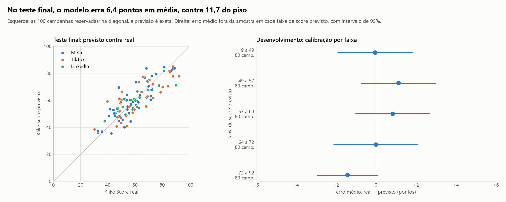
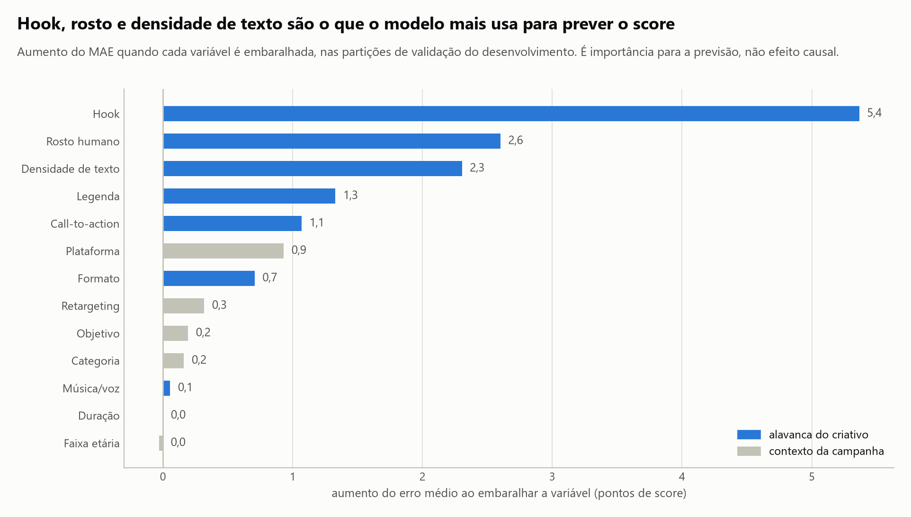
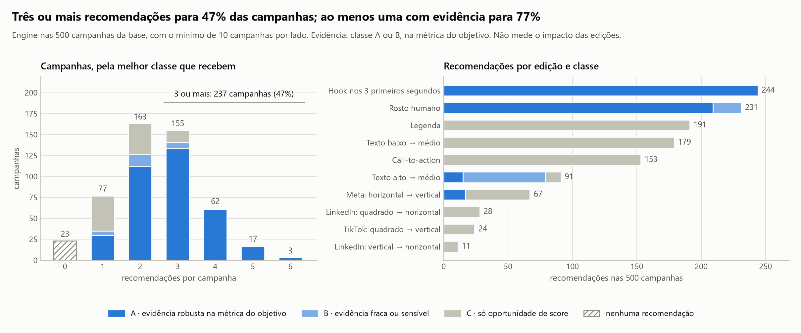

# Klike Data Science Challenge

Análise de 500 campanhas de vídeo em Meta, TikTok e LinkedIn para entender o que faz um criativo performar, prever o **Klike Score** e transformar isso em recomendações acionáveis.

**Autor:** Murilo Godoy

## Resumo

A Parte 1, de análise exploratória, em seis pontos:

- **A base tinha 10 registros inconsistentes,** em que as contas do funil não fecham. Todos foram corrigidos, sem descartar nenhuma campanha. Em 5, duas contas independentes confirmam qual valor está errado; nos outros 5, a escolha do valor se apoia em plausibilidade, e o log marca isso para revisão. Quatro deles triplicavam a média de impressões.
- **Hook e rosto humano são os atributos que mais pesam, e pesam na atenção.** Campanhas com hook têm CTR cerca de 50% maior, e com rosto, engajamento cerca de 40% maior. Não encontramos evidência de que se associem à conversão de quem clica ou ao ROAS.
- **Conversão e ROAS variam mais com o público:** com retargeting, os dois são cerca de duas vezes maiores.
- **Não encontramos evidência robusta de que algum atributo funcione diferente entre as plataformas,** o que não prova que os efeitos sejam iguais. O que muda é o patamar, mesmo entre campanhas parecidas: o clique no LinkedIn custa de 4 a 5 vezes o do TikTok, e o engajamento do TikTok é bem maior que o das outras. Na Meta, vídeos horizontais têm 5 pontos de score a menos que os verticais.
- **Duração não mostra efeito detectável** em nenhuma plataforma.
- **O Klike Score responde mais ao criativo que ao público,** mas dá pontos a legenda, CTA e texto médio, que não mostram efeito robusto em performance. Vale validar esses pesos.

A Parte 2, de modelagem, em cinco pontos:

- **Dá para prever o score antes de gastar.** Um modelo linear (Ridge) com o contexto da campanha e os atributos do criativo erra 6,4 pontos em média nas 100 campanhas reservadas para o teste final, numa escala de 0 a 100. É 45% menos que prever a média, compatível com a validação cruzada.
- **O modelo separa bem criativos bons de fracos, mas não crava números.** Quando ele prevê 10 pontos ou mais de diferença entre dois criativos da mesma plataforma, o apontado como melhor tem de fato o score maior em 93% dos pares do desenvolvimento, numa análise exploratória. Abaixo de 5 pontos previstos, a comparação é pouco melhor que um chute. Nos extremos, as previsões são puxadas para o centro, e no LinkedIn o erro tende a ser maior.
- **Ele aprendeu o que a EDA mostrou.** Hook, rosto e densidade de texto são o que mais pesa na previsão, com efeitos em pontos próximos aos da Parte 1. Isso mostra o que ajuda a prever, não o que causa o score.
- **Nesta base simulada, a performance realizada explica só parte do score.** Um modelo comparativo que acrescenta CTR, conversão e outras taxas, conhecidas só depois do gasto, erra cerca de 1 ponto a menos. Mesmo nele, o criativo pesa mais que as taxas.
- **O modelo está pronto para uso.** Um comando recria o modelo final, e uma única chamada valida uma campanha nova e devolve o score previsto. O arquivo também guarda quantas campanhas parecidas existem para cada combinação de atributos, para a Parte 3 não extrapolar.

A Parte 3, o recommendations engine, em cinco pontos:

- **O engine sugere edições do vídeo com a força da evidência à vista.** Cada recomendação separa o score previsto, a associação com a métrica do objetivo, a classe de evidência e quanta base existe para comparar. A ordem segue a evidência na métrica do objetivo, não só o score, e a saída abre com um resumo executivo das três primeiras, com todas as ressalvas de cada uma.
- **Três ou mais recomendações para 49% das campanhas, e nenhuma para 4%.** Quem recebe menos já segue a maior parte do catálogo, e o engine diz isso em vez de completar a lista. 79% das campanhas recebem ao menos uma recomendação com evidência na métrica do objetivo, mas só 34 recebem três ou mais com evidência.
- **Mais da metade das recomendações é só oportunidade de score.** Legenda, CTA e texto baixo → médio sobem o score previsto sem evidência de performance; a saída as apresenta como hipóteses para teste A/B.
- **Mais música em relação à voz entra só para retenção.** Cada +0,1 de música se associa a 3,9% mais retenção, com evidência robusta, enquanto o score previsto cai meio ponto. A saída mostra as duas coisas e nunca apresenta a edição como melhora de score.
- **As escolhas operacionais pouco mudam o resultado.** Entre 5 e 20 campanhas por lado, só a troca de formato no LinkedIn depende do mínimo, e a primeira recomendação é a mesma em seis ordens alternativas em 346 das 408 campanhas com duas ou mais.

A Parte 4, a visão de produto, em três pontos:

- **Do metadado ao vídeo, com validação.** O vídeo preencheria os atributos do criativo e permitiria recomendações localizadas no tempo, desde que a extração concorde com as marcações em que as evidências se apoiam.
- **Produção reaproveitando o engine, não o modelo simulado.** O contrato, as regras, os testes e a auditoria vão para produção; os coeficientes estimados em 500 campanhas simuladas, não.
- **Validar antes de sofisticar.** A primeira evolução é testar as recomendações em A/B com dados reais, porque associação não é efeito.

| Parte | Pergunta do desafio | Onde está |
| :-- | :-- | :-- |
| 1.1 | Perfil dos dados, faltantes e outliers | [Seção](#parte-11--perfil-e-qualidade-dos-dados) e [notebook 01](notebooks/01_data_audit.ipynb) |
| 1.2 a 1.4 | Atributos que importam, padrões por plataforma e visualizações | [Seção](#partes-12-a-14--o-que-acompanha-a-boa-performance-dos-criativos) e [notebook 02](notebooks/02_eda_insights.ipynb) |
| 2 | Modelagem do Klike Score | [Seção](#parte-2--modelagem-do-klike-score) e [notebook 03](notebooks/03_modeling.ipynb) |
| 3 | Recommendations engine | [Seção](#parte-3--recommendations-engine) e [notebook 04](notebooks/04_recommendations.ipynb) |
| 4 | Visão de produto | [Seção](#parte-4--visão-de-produto) e [documento](docs/visao_de_produto.md) |
| Extra | Demonstração interativa | [Seção](#extra--klike-interactive-lab) e [documento](docs/interactive_lab.md) |

---

## A decisão que guia o case inteiro

Antes de qualquer gráfico, separei as colunas pelo **momento em que a informação existe**:

| Grupo | Exemplos | Quando existe |
| :-- | :-- | :-- |
| **Contexto** | plataforma, categoria, objetivo, público | antes da veiculação |
| **Criativo** | hook, rosto, legenda, CTA, duração, formato, densidade de texto | antes da veiculação |
| **Performance** | impressões, CTR, CPC, conversões, ROAS, engajamento | só depois da veiculação |

Um score que só pode ser calculado depois da veiculação não ajuda a decidir o que veicular. Por isso, um modelo que usa CTR para prever o score responde a uma pergunta menos útil do que parece: ele depende de algo que só existe depois do gasto. Essa separação define como o modelo é avaliado e o que o recommendations engine pode sugerir: só mudanças no criativo, que o time de criação controla.

---

## Como pensei

Três perguntas guiaram cada etapa:

1. **Os dados são confiáveis?** Antes de procurar padrões, conferi se as contas do funil fecham. Dez registros não fechavam, e corrigi-los mudou médias em até três vezes.
2. **O efeito é do criativo ou do contexto?** Atributos do criativo andam junto com plataforma, público e objetivo. Por isso, todo efeito vem de uma regressão que mantém fixos o contexto e os outros atributos do criativo. Sem esse cuidado, os vídeos quadrados do TikTok pareceriam ter 13 pontos de score a menos que os verticais, quando a diferença é de menos de 4.
3. **A diferença é real ou acaso?** Todo efeito tem intervalo de confiança, e cada família de testes recebe a correção de Benjamini-Hochberg. Só chamo de robusto o que resiste a ela; o resto é indício ou inconclusivo.

**O que deixei de fora de propósito:**

- **Remover outliers por regra estatística.** Corrigi só registros em que as contas do funil não fecham, e mantive os extremos reais.
- **Imputar faltantes antes do EDA.** Isso inventaria valores e vazaria informação para o modelo, como explica a Parte 1.1.
- **Comparar criativos por volume.** Volume mede verba, então usei taxas.
- **Recomendar mudanças de duração.** A base não mostra efeito.
- **Transformar zeros com log(1 + y).** O resultado muda com a unidade da métrica. Para manter as campanhas sem conversão, usei modelos de contagem.

---

## Parte 1.1 · Perfil e qualidade dos dados

> Notebook completo: [`notebooks/01_data_audit.ipynb`](notebooks/01_data_audit.ipynb)

A base é pequena e bem estruturada: 500 campanhas de 2024, sem duplicatas e sem categorias inválidas. Mas ela esconde **10 registros inconsistentes**, **7 colunas com faltantes** e **3 métricas que batem num limite**.

### Os erros foram encontrados com as próprias contas do funil

As métricas de mídia são redundantes entre si:

- impressões = cliques ÷ CTR
- gasto = cliques × CPC
- ROAS = receita ÷ gasto

Em vez de cortar outliers por uma regra estatística genérica, testei se essas contas fecham. Quando uma não fecha, as outras permitem **reconstruir** o valor e, em metade dos erros, apontam sozinhas **qual** campo está errado.

A regra genérica teria errado dos dois lados. Aplicada ao gasto bruto, a regra do intervalo interquartil marca 61 campanhas, 58 delas legítimas. Em escala log, os três gastos corrigidos nem chegam a ser marcados. As contas do funil isolam exatamente os 10 registros inconsistentes, sem marcar nenhuma campanha coerente.


Um exemplo: em três campanhas, gasto ≠ cliques × CPC. O ROAS desempata, porque foi calculado com o gasto verdadeiro. Ele mostra que o erro está no CPC, registrado entre R$ 20 e R$ 26 por clique quando o maior CPC legítimo da Meta é R$ 1,37. Nenhuma linha foi descartada, e cada correção fica registrada com a evidência em [`reports/data_corrections.csv`](reports/data_corrections.csv).

**Nem toda correção tem a mesma força, e o log diz qual é qual.** Em 5 dos 10 erros, duas contas independentes confirmam o campo errado, como no exemplo acima: a base é a **identidade**. Nos outros 5, as contas mostram o erro, mas não qual campo está errado. É o caso das 4 impressões, em que nenhuma conta separa impressões de CTR, e do KLK-0224, de Branding, sem receita para o ROAS desempatar. Ali a base é a **plausibilidade**: o código só corrige quando uma versão cai dentro da faixa observada nas campanhas em que as contas fecham e a outra cai fora dela. As alternativas ficam bem longe: um CTR de 8 a 80 vezes abaixo do menor da base, ou um CPC 3,5 vezes acima do maior da Meta. Se as duas versões fossem plausíveis, o registro iria para revisão manual. A coluna `basis` do log marca essas 5 para conferência com a fonte dos dados. Sem essas 5 campanhas, os principais efeitos ficam próximos: o hook no CTR vai de +51,3% para +51,1%, o rosto no engajamento, de +42,7% para +43,5%, e o hook no Klike Score, de +17,14 para +17,09 pontos. A exceção é o nível de evidência do texto alto no ROAS: o efeito quase não muda, de −24% para −22%, mas o resultado passa de robusto a indício (q de 0,028 para 0,055). É o único dos 68 testes da Parte 1.2 que muda de nível.

O impacto não é pequeno. **Quatro linhas, 0,8% da base, triplicavam a média de impressões**, e os três gastos corrigidos inflavam o gasto total em cerca de 11%.

### Decisões

| Situação | Casos | Decisão | Por quê |
| :-- | :-- | :-- | :-- |
| Impressões infladas | 4 | Recalcular: cliques ÷ CTR | Cliques confirmados pelo gasto; o CTR alternativo seria implausível (plausibilidade) |
| CPC fora de escala | 3 | Recalcular: gasto ÷ cliques | O ROAS confirma o gasto (identidade) |
| Gasto fora de escala | 3 | Recalcular: cliques × CPC | O ROAS confirma cliques × CPC em 2 (identidade); no KLK-0224, sem receita, só o CPC registrado é plausível (plausibilidade) |
| CPC e receita faltantes | 28 e 25 | Recuperar pelas mesmas contas | Recuperação exata no CPC; erro máximo de 0,5% do gasto na receita |
| Faltantes em duração, legenda, música/voz, tempo assistido e engajamento | 27 a 46 por coluna | Imputar dentro do pipeline do modelo, na Parte 2, ajustado só no treino. Legenda sem marcação vira a categoria "desconhecida"; indicadores de ausência foram testados na Parte 2 e ficaram de fora, por não trazerem ganho | Nenhum teste encontrou relação entre a ausência e as variáveis observadas, o que é compatível com MCAR; descartar perderia 30% da base |
| CTR travado em 15% e engajamento em 10% | 55 e 11 | Manter, com flag | Parecem tetos de registro: muitos valores exatamente no limite e nenhum acima. O valor real pode ter sido maior |
| Tempo médio assistido igual à duração do vídeo | 32 | Manter, com flag | Exigiria que todos vissem o vídeo inteiro; tratado como limite da métrica |
| Receita zero em Branding | 63 | ROAS "não se aplica" | Branding não mede receita, mesmo com conversões |
| Extremos coerentes, como uma campanha com 1,57 milhão de impressões | ex.: KLK-0435 | Manter; usar mediana e escala log | As contas fecham; é variação real |

### Ordem do tratamento dos dados

1. **Limpeza, antes de qualquer análise:** correção dos 10 registros inconsistentes, recuperação de CPC e receita, marcação dos tetos e do ROAS de Branding. Os dois notebooks carregam a base já limpa.
2. **EDA com os valores disponíveis:** os faltantes que restam, de 5% a 9% por coluna, não são imputados. Cada análise usa as campanhas que têm o valor, e a legenda ausente vira a categoria "desconhecida". Testei se a ausência é aleatória de três formas: a relação com cada outra coluna, um modelo tentando prever onde estão os faltantes e variáveis muito correlacionadas usadas como pista. Nenhuma mostrou sinal: a ausência é compatível com acaso (MCAR). Isso não prova MCAR, mas, se a ausência for aleatória, usar os valores disponíveis não distorce os resultados, e a tabela abaixo mostra que as conclusões não mudam com as alternativas.
3. **Imputação no pipeline do modelo, na Parte 2,** ajustada só nos dados de treino para não vazar informação do teste.

Imputar antes do EDA inventaria valores impossíveis, como vídeos assistidos por mais tempo do que duram, e não mudaria as conclusões. Refiz as estimativas principais das três formas:

| Efeito | Valores disponíveis | Imputação pela mediana | Só campanhas completas |
| :-- | :-- | :-- | :-- |
| Hook no CTR | +51% | +50% | +50% |
| Rosto no engajamento | +43% | +42% | +31% |
| Hook no Klike Score | +17,1 pts | +17,0 pts | +17,7 pts |

### O que isso muda nas próximas etapas

1. **Separar o efeito do criativo do efeito da plataforma.** O TikTok não tem nenhum vídeo horizontal, e o LinkedIn quase não tem público de 18 a 24 anos. Por isso, todo efeito é estimado com a plataforma como controle, e o formato é analisado dentro de cada plataforma.
2. **Usar mediana e escala log** para métricas de volume, que variam milhares de vezes entre campanhas.
3. **Analisar ROAS só fora de Branding.**
4. **Imputar só dentro do pipeline de modelagem**, nunca antes de separar treino e teste.
5. **Modelar o Klike Score diretamente.** Ele vai de 10 a 99, com média de 60, e é quase simétrico.

---

## Partes 1.2 a 1.4 · O que acompanha a boa performance dos criativos

> Notebook completo: [`notebooks/02_eda_insights.ipynb`](notebooks/02_eda_insights.ipynb)

**Como medi.** Volumes como cliques e conversões crescem com o orçamento, então comparo taxas: CTR, engajamento, retenção, conversão por clique, conversões por mil impressões e ROAS. Elas quase não andam juntas, e por isso acompanho todas. O Klike Score fica separado delas, porque é a métrica da própria Klike, não um resultado de mídia. Cada efeito vem de uma regressão que mantém fixos plataforma, categoria, objetivo, faixa etária, retargeting e os outros atributos do criativo. A leitura é: *mantido fixo o resto no modelo, as campanhas com o atributo performam X% diferente*. É um ajuste por regressão, e não um pareamento de campanhas parecidas. É associação, não prova de causa; a confirmação viria de testes A/B.

**Quando um resultado conta.** Com dezenas de testes, alguns passariam de p < 0,05 só por acaso. Por isso, cada família de testes, o conjunto que responde a uma mesma pergunta, recebe a correção de Benjamini-Hochberg. Um resultado é **robusto** quando resiste à correção, **indício** quando só passa no teste isolado e **inconclusivo** quando nem isso. O notebook lista as oito famílias e o tamanho de cada uma.

Controlar o contexto muda as conclusões. Na comparação direta, os vídeos quadrados do TikTok parecem ter 13 pontos de score a menos que os verticais. Com o resto mantido igual, a diferença cai para menos de 4, porque só um terço desses vídeos tem hook, contra metade dos verticais.

### Boas práticas se somam


Em média, cada uma das quatro boas práticas, hook, rosto, legenda e CTA, vem com cerca de 11 pontos a mais de Klike Score. Elas não pesam igual: o hook se associa a cerca de 17 pontos, e legenda e CTA, a cerca de 8. Criativos com as quatro têm CTR mediano 2,6 vezes maior que criativos sem nenhuma.

### Parte 1.2 · Hook e rosto se associam a mais atenção


- **Hook é o atributo mais forte:** campanhas com hook têm 51% mais CTR, 38% mais engajamento e 39% mais retenção.
- **Rosto humano vem em segundo:** 43% mais engajamento e 23,5% mais CTR. Na retenção, +11%, fica só um indício, que não resiste à correção.
- **Não há evidência de que hook e rosto se associem à conversão de quem clica ou ao ROAS.** Ainda assim, campanhas com hook e rosto têm mais conversões por mil impressões, porque recebem mais cliques. O ROAS não acompanha por uma conta simples: ROAS é conversão por clique vezes ticket médio, dividido pelo CPC, e nenhum dos três tem diferença detectável com hook ou rosto.
- **Texto demais anda com desempenho pior.** Densidade alta vem com retenção 19% menor e ROAS 24% menor, em parte por um ticket médio menor. É o único atributo do criativo associado ao ROAS; esse resultado é robusto na base completa, mas o nível de evidência é sensível às 5 correções por plausibilidade da Parte 1.1. A queda nas conversões por mil impressões fica como indício.
- **Música e voz são ajuste fino.** Mais música se associa a um pouco mais de retenção e a um score um pouco menor, com efeitos pequenos.
- **Conversão e ROAS variam mais com o público.** Com retargeting, os dois são cerca de duas vezes maiores, mas o Klike Score é só 4,5 pontos maior, contra 17 do hook. O score se comporta como uma medida da qualidade do criativo, não do público.

**Os zeros não mudam as conclusões.** A regressão em log descarta as 19 campanhas sem conversão, todas sem retargeting. Refiz as estimativas de conversão e ROAS com dois modelos que mantêm os zeros: Poisson na taxa e binomial negativa, o modelo usual para contagens com sobredispersão. Hook, rosto e retargeting chegam à mesma conclusão em todos os modelos; texto alto também, exceto na conversão por clique, onde fica como indício. A novidade é um indício a favor da legenda nas conversões por mil impressões: +14% e inconclusivo no log, +23% e significativo na binomial negativa. Descartei log(1 + y), outra saída comum, porque o resultado depende da unidade: o efeito do hook iria de 0% a +85% só trocando "por impressão" por "por milhão".

**Um ponto para a própria Klike.** Score e performance concordam sobre hook, rosto e texto alto. Mas o score dá de 7 a 8 pontos para legenda, CTA e texto médio, que não mostram efeito robusto em nenhuma métrica de performance nesta base. A legenda tem só o indício nas conversões, que depende do modelo. Talvez esses efeitos existam e sejam pequenos demais para 500 campanhas; talvez o score siga boas práticas de mercado que estes dados não confirmam. Vale validar esses pesos com testes controlados.

### Parte 1.3 · Sem evidência de efeitos diferentes; o patamar muda


**As plataformas diferem no custo e no engajamento.** Nas medianas, o clique no LinkedIn custa cinco vezes o do TikTok, o ROAS mediano do LinkedIn fica abaixo de 1, e o engajamento do TikTok é quase o dobro do das outras. CTR, retenção e conversão por clique não diferem de forma significativa.

Essas medianas são uma comparação direta, e a composição das plataformas não é igual. A mistura de categorias, objetivos e retargeting é parecida, mas a de faixa etária muda muito: 44% das campanhas do TikTok falam com 18 a 24 anos, contra 2% no LinkedIn. Comparando campanhas com o mesmo público, categoria, objetivo e criativo, as diferenças continuam: o CPC do LinkedIn fica 4,6 vezes o do TikTok, e o engajamento do TikTok, 76% acima do da Meta. Na prática, um criativo deve ser comparado com o patamar da própria plataforma.


**Não encontramos evidência robusta de que algum atributo funcione diferente entre as plataformas.** Comparar quais efeitos dão significativos em cada plataforma engana, porque o LinkedIn tem três vezes menos campanhas. O teste certo compara os efeitos diretamente. Dos 30 testes, só 3 ficam abaixo de 0,05, contra 1,5 esperados por acaso, e nenhum resiste à correção para múltiplos testes. O mesmo vale para faixa etária, categoria e objetivo. Mas não ter evidência de diferença não prova que os efeitos sejam iguais: no LinkedIn, com 83 campanhas, o efeito do rosto no engajamento pode ir de −32% a +152%. A conclusão honesta é que a base não mostra diferença, e que diferenças moderadas não podem ser descartadas.

| | Meta | TikTok | LinkedIn |
| :-- | :-- | :-- | :-- |
| **Efeito dos atributos** | Sem diferença detectada | Sem diferença detectada | Sem diferença detectada; intervalos largos |
| **Patamar** | Referência | Engajamento 76% maior; CPC mais baixo; maior ROAS | CPC de 4 a 5 vezes o do TikTok; ROAS mediano abaixo de 1 |
| **Formato** | Horizontal com 5 pontos de score e 39% de engajamento a menos | Tendência a favor do vertical | Tendência a favor do horizontal |
| **Duração** | Sem efeito detectável | Sem efeito detectável | Sem efeito detectável |

Os detalhes de formato e duração estão em [`02_formato.png`](reports/figures/02_formato.png) e [`02_duracao.png`](reports/figures/02_duracao.png). Sobre duração, o senso comum diz que vídeos curtos performam melhor. Mas, mantendo o resto igual, dobrar a duração muda o CTR em +1%, com intervalo de −8% a +10%, e nenhum dos 12 testes de duração fica abaixo de 0,05.

### Parte 1.4 · As visualizações

Os seis gráficos das Partes 1.2 e 1.3 foram feitos para um time de marketing. Cada um responde uma pergunta e tem um título que já diz a resposta. Todos usam uma cor fixa por plataforma. No mapa de efeitos, azul é maior e vermelho é menor; cor forte marca resultado robusto, hachura marca indício, e cor apagada, inconclusivo.

### O que isso muda nas Partes 2 e 3

- **O modelo pré-veiculação tem boas chances de funcionar.** O Klike Score responde fortemente aos atributos do criativo e pouco ao público.
- **O engine vai ser contextual, sem depender de estimativas instáveis.** O efeito geral de cada atributo serve de referência, porque é o mais preciso. A ideia inicial era somar a ele a evidência de cada segmento, encolhida em direção ao efeito geral na proporção da sua incerteza. A Parte 3 testou essa alternativa e a descartou: a variância entre plataformas ficou em zero na maioria dos casos, e o encolhimento devolveria o próprio efeito geral. O contexto entra pelo que se aplica à campanha, pela métrica do objetivo, pelo formato dentro de cada plataforma e pelo suporte histórico, para que um grupo pequeno não gere uma recomendação baseada em ruído.
- **Toda recomendação vai trazer seu nível de evidência e separar score de performance.** Recomendar um CTA tende a subir o score, mas não há evidência de que melhore a performance, e o engine precisa dizer isso.
- **Duração fica fora das recomendações.** Não há evidência nesta base para sugerir mudanças.

---

## Parte 2 · Modelagem do Klike Score

> Notebook completo: [`notebooks/03_modeling.ipynb`](notebooks/03_modeling.ipynb)

A modelagem segue um protocolo definido antes dos experimentos formais. Esta seção resume as decisões, a certificação no teste, a interpretação e o uso do modelo final; o notebook traz os detalhes.

### Dois cenários, um principal

| | Modelo A · pré-publicação | Modelo B · pós-publicação |
| :-- | :-- | :-- |
| **Usa** | Contexto da campanha e atributos do criativo: 13 colunas | Tudo do modelo A, mais taxas de performance |
| **Papel** | Principal: pontua criativos novos e apoia o recommendations engine | Comparativo: mede quanto o score acompanha a performance realizada |

O modelo A é o principal porque é o único que pode ser usado antes de gastar, quando a decisão sobre o criativo acontece. Um teste automatizado impede que métricas de performance, o próprio score, o identificador ou a data entrem nele, e a mesma função prepara o histórico e uma campanha nova. O modelo B não serve para avaliar um criativo que ainda não foi veiculado. Uma ressalva vale para os dois: reproduzir o score da Klike numa base simulada não é o mesmo que prever vendas.

### O que a exploração inicial indicou

Antes do protocolo, uma exploração nas 500 campanhas mostrou que:

- o contexto sozinho não prevê o score;
- criativo e contexto juntos explicam cerca de dois terços da variação;
- um modelo linear foi melhor que um gradient boosting;
- as métricas de performance acrescentam explicação, mas só existem depois do gasto.

Esses números orientaram o plano e não valem como desempenho, porque a exploração viu todas as campanhas, inclusive as que depois foram para o teste.

### Como os modelos são avaliados

- **Desenvolvimento e teste.** 400 campanhas para desenvolver e 100 para o teste final, com a mesma proporção de plataformas. O teste é consultado uma única vez, depois que modelo, features e hiperparâmetros estiverem decididos.
- **Validação cruzada aninhada.** Os candidatos são comparados nas mesmas 25 partições do desenvolvimento, e os hiperparâmetros são escolhidos só dentro do treino de cada partição.
- **Decisão.** A métrica principal é o MAE, em pontos de score. Uma alternativa mais complexa precisa de uma melhora relevante e estável; na dúvida, fica a mais simples.
- **Checagem temporal.** Treinar nos três primeiros trimestres e avaliar no quarto, como robustez complementar.

### Experimentos e escolha do modelo


**M1 · Algoritmos.** A hipótese era que, com os efeitos aditivos vistos na Parte 1, um modelo linear bastaria. Nas mesmas 25 partições do desenvolvimento, com média e desvio entre elas:

| Modelo | MAE (pontos) | R² | Spearman |
| :-- | :-- | :-- | :-- |
| Dummy, a média do treino | 12,8 ± 0,9 | −0,01 | não se aplica |
| Ridge | 7,0 ± 0,5 | 0,69 | 0,82 |
| HistGradientBoosting | 7,2 ± 0,6 | 0,66 | 0,79 |

A Ridge erra, em média, 7 pontos numa escala de 0 a 100: 45% menos que o piso, com melhora em todas as partições. O boosting não melhora a Ridge: erra 0,23 ponto a mais e só a supera em 32% das partições. **Decisão: Ridge**, mais simples, mais estável e interpretável, já que cada coeficiente vira pontos de score.

**F1 a F3 · Features, na Ridge.** Cada alteração foi comparada com a Ridge base, nas mesmas partições:

| Experimento | Resultado | Decisão |
| :-- | :-- | :-- |
| F1 · indicadores de ausência para duração e música/voz | MAE 0,03 ponto pior; melhor em 40% das partições | Fica de fora: os indicadores não trouxeram ganho consistente. Isso é compatível com a Parte 1, mas não prova que a ausência seja aleatória |
| F2 · duração em log | Nenhuma diferença; cada versão vence em cerca de metade das partições | Fica de fora: no empate, fica a forma mais simples |
| F3 · interação plataforma × formato | MAE 0,23 ponto menor (3,3%); melhor em 92% das partições | Entra |

O F3 ficou abaixo da referência de 0,5 ponto do protocolo, então a decisão pesou os outros critérios: a melhora é muito estável, custa só três termos, mantém o modelo linear e deixa o efeito do formato específico de cada plataforma. Sem a interação, o modelo aplicaria o mesmo efeito de formato a todas as plataformas, embora o vídeo horizontal tenha score menor na Meta e seja o formato mais usado no LinkedIn. Combinações sem campanhas suficientes no treino, como TikTok horizontal, não ganham efeito próprio.

**Modelo escolhido:** Ridge com as 13 features de pré-publicação e a interação plataforma × formato. Nas partições do desenvolvimento, ele erra 6,78 pontos em média, mas essas são as mesmas partições que orientaram a escolha, então o número pode trazer algum otimismo de seleção. A estimativa que vale é a da certificação, a seguir.

### Certificação no teste

Com a especificação registrada no código, o modelo foi treinado nas 400 campanhas de desenvolvimento e avaliado uma única vez nas 100 reservadas. Os intervalos de 95% vêm de bootstrap das campanhas do teste, com o modelo treinado fixo: medem a incerteza de avaliar em 100 campanhas, não a de um novo treinamento.

| | Modelo escolhido, no teste | Dummy, no teste | Validação cruzada |
| :-- | :-- | :-- | :-- |
| MAE (pontos) | 6,43 (5,55 a 7,33) | 11,67 (10,09 a 13,39) | 6,78 ± 0,48 |
| RMSE (pontos) | 7,92 (6,86 a 8,96) | 14,37 (12,58 a 16,11) | 8,50 ± 0,67 |
| R² | 0,70 (0,57 a 0,78) | 0,00 (−0,06 a 0,00) | 0,71 ± 0,04 |
| Spearman | 0,83 (0,74 a 0,88) | não se aplica | 0,83 ± 0,02 |

O desempenho no teste é compatível com a validação cruzada: o intervalo do MAE inclui os 6,78 esperados, e R² e Spearman ficam onde a validação indicava. Contra o Dummy, o erro cai 5,24 pontos, com intervalo de 3,59 a 6,95, uma diferença pareada, calculada nas mesmas campanhas. Em 45% das campanhas, o erro fica abaixo de 5 pontos, e em 79%, abaixo de 10. O MAE do teste ficou um pouco abaixo do esperado, dentro da variação de uma amostra de 100 campanhas. Isso reduz, mas não elimina, o risco de otimismo de seleção, porque a exploração inicial teve contato com as 500 campanhas. A diferença de 0,35 ponto para a validação é uma comparação descritiva: cabe no intervalo do MAE, que mede a incerteza de avaliar este modelo fixo em 100 campanhas. A largura desse intervalo não é a menor diferença detectável entre modelos: comparar dois modelos exige o intervalo da diferença pareada, como o calculado contra o Dummy. O resultado não mudou nenhuma escolha.



### Onde o modelo erra

Os diagnósticos usam as previsões fora da amostra das 400 campanhas de desenvolvimento, quatro vezes mais que o teste:

- **Calibração.** Em todas as faixas de score previsto, o erro médio fica entre −1,4 e +1,1 ponto, com intervalos que incluem o zero.
- **Extremos.** Os 10% com maior score real, 85 em média, são previstos em 79; os 10% com menor, 31, em 39. É regressão à média, esperada em qualquer modelo que não explica toda a variação: o modelo separa criativos bons de fracos melhor do que crava o score de um criativo excepcional.
- **Segmentos.** O LinkedIn tem o maior erro, 8,0 ± 1,4 pontos, contra 6,3 ± 0,7 na Meta, com só 66 campanhas. No teste, que tem 17 campanhas do LinkedIn, a ordem se inverteu, dentro da incerteza de um grupo tão pequeno. Entre categorias, as margens se sobrepõem. Não encontramos evidência clara de viés médio sistemático nos segmentos avaliados: os erros médios ficam perto de zero, o que não prova que o viés seja nulo. As margens são aproximações normais, grosseiras em grupos pequenos.
- **Ordenação, pela diferença real.** Em pares da mesma plataforma com diferença real de 10 pontos ou mais, o modelo aponta o melhor criativo em 92% das vezes no desenvolvimento e em 94% no teste. Abaixo de 5 pontos, acerta 58%, pouco acima de um chute. É um diagnóstico retrospectivo, porque a diferença real só existe depois da veiculação.
- **Ordenação, pela diferença prevista.** É a informação que o produto tem antes de veicular. Quando a diferença prevista é de 10 pontos ou mais, o criativo apontado teve de fato o maior score em 93% dos pares do desenvolvimento; com 5 pontos ou mais, em 88%; abaixo de 5, em 58%. A análise é exploratória: os pares compartilham campanhas, e previsões de partições diferentes vêm de modelos diferentes, embora a conta só com pares da mesma partição dê quase o mesmo resultado. Nenhum limiar foi escolhido, e o teste não foi usado para isso.
- **Tempo.** Treinado nos três primeiros trimestres, o modelo erra 6,5 pontos no quarto, sem sinal de piora.

### O que o modelo aprendeu



| Atributo | Modelo (pontos) | EDA (pontos) |
| :-- | :-- | :-- |
| Hook nos 3 primeiros segundos | +17,4 | +17,1 |
| Rosto humano | +11,3 | +11,8 |
| Legenda | +8,2 | +8,3 |
| Call-to-action | +7,6 | +8,2 |
| Texto médio (vs. baixo) | +7,4 | +6,9 |
| Texto alto (vs. baixo) | −7,4 | −7,4 |
| Retargeting | +4,5 | +4,5 |

- **O modelo aprendeu o que a EDA mostrou.** Os efeitos em pontos ficam a no máximo 0,6 ponto dos da Parte 1 e variam pouco entre partições. Música/voz e duração quase não pesam, e o contexto pesa menos que o criativo.
- **Formato por plataforma.** Na Meta, o horizontal tem 4,9 pontos a menos que o vertical; no TikTok, o quadrado tem 3,0 a menos. No LinkedIn, o vertical tem 8,4 a menos que o horizontal, mas são só 11 campanhas verticais, e na EDA esse resultado é tendência, não conclusão. TikTok horizontal não existe na base e fica sem suporte.
- **Importância para prever não é efeito causal.** A importância por permutação mostra quanto o modelo depende de cada variável para acertar o score, e os coeficientes descrevem associações ajustadas pelo resto do modelo. Nenhum dos dois mostra o que acontece quando o criativo muda. Isso vale em especial para plataforma × formato: formato e plataforma andam junto com outras escolhas, e mudar o formato de um vídeo pronto não garante a diferença prevista.

### Modelo B: o score acompanha a performance?

Com as sete taxas de performance, o mesmo protocolo e a mesma especificação, o modelo B erra 5,42 pontos na validação cruzada, contra 6,78 do A, com melhora em todas as partições. No teste, consultado depois do A, erra 5,29 contra 6,43: 1,13 ponto a menos, com intervalo de 0,26 a 2,00. Mesmo no B, embaralhar os atributos do criativo aumenta o erro em 7,5 pontos, contra 3,8 das taxas. **O score acompanha a performance realizada só em parte e premia atributos do criativo por conta própria,** como legenda e CTA, que não mostram efeito robusto em performance. Essa conclusão vale para o score desta base simulada e não deve ser transferida automaticamente para a metodologia real da Klike. O modelo B não serve para criativos novos e não entra no recommendations engine.

### O que isso muda para a Klike

- **Pontuar um criativo antes de gastar é viável,** com erro típico de 6 a 7 pontos.
- **O score previsto serve para separar criativos, não para cravar números.** A diferença prevista indica a confiança na comparação: a partir de 10 pontos, ela costuma apontar o criativo certo; abaixo de 5, não deve decidir uma escolha. Um limiar para uso real precisa ser validado em dados novos.
- **O recommendations engine, na Parte 3, parte dos efeitos do modelo.** Cada sugestão traz o nível de evidência da Parte 1 sobre performance, o LinkedIn pede mais cautela e combinações sem suporte, como TikTok horizontal, não recebem recomendação.
- **Vale validar com a Klike os pesos do score** para legenda, CTA e texto médio, lembrando que este score é simulado.

### Modelo final: como treinar e usar

O modelo final é a especificação certificada, a Ridge com a interação plataforma × formato e penalização alpha 1, reajustada nas 500 campanhas sem nova busca de hiperparâmetros. Como o reajuste também treina com as campanhas do teste, ele não ganha métrica própria: as oficiais são as da certificação. O reajuste muda pouco o modelo: nenhum efeito muda de sinal, e as alavancas do criativo variam no máximo 0,6 ponto.

**Treinar e salvar.** Um comando reajusta o modelo e salva, num arquivo joblib, o pipeline completo, o suporte histórico e os metadados:

```bash
python -m klike.train
```

```
Modelo salvo em models/klike_score_model.joblib
Treino: 500 campanhas de klike_challenge_dataset.csv | alpha 1 | interações: TikTok × quadrado, LinkedIn × quadrado, LinkedIn × horizontal
Métricas oficiais, da certificação: MAE 6,43 (intervalo de 95%: 5,55 a 7,33)
```

O arquivo não vai para o repositório: o comando o recria a partir do CSV. Os metadados registram a especificação, as entradas aceitas, as métricas oficiais, a impressão digital (SHA-256) do arquivo de dados e as versões usadas. O modelo foi gerado com Python 3.13.3, scikit-learn 1.9.1, numpy 2.5.4, pandas 2.3.3 e joblib 1.6.0. Ao carregar com outra versão do scikit-learn, um aviso recomenda gerar o arquivo de novo.

**Carregar e prever.** Uma única chamada valida a campanha, prepara as features, aplica o pipeline e limita o score à escala de 0 a 100:

```python
from klike.predictor import KlikeScorePredictor

predictor = KlikeScorePredictor.load()  # models/klike_score_model.joblib
campanha = {
    "platform": "TikTok",
    "category": "E-commerce",
    "objective": "conversions",
    "target_audience_age": "18-24",
    "is_retargeting": False,
    "video_duration_s": 15,      # opcional
    "format": "vertical",
    "has_subtitle": True,        # opcional
    "has_cta": True,
    "has_hook": True,
    "has_face": True,
    "text_density": "medium",
    "music_voice_ratio": 0.4,    # opcional
}
scores = predictor.predict(campanha)  # pd.Series, um score por campanha
round(scores.iloc[0], 1)              # 88.3
```

- **Entrada:** um dicionário, uma lista de dicionários ou um DataFrame, com os campos em qualquer ordem.
- **Campos opcionais:** duração, legenda e música/voz podem faltar. O pipeline imputa a mediana do treino, e a legenda sem marcação vira uma categoria própria.
- **Métricas de performance não são necessárias.** Colunas do histórico, como CTR ou ROAS, são ignoradas se vierem junto.
- **Erros claros:** categorias desconhecidas, valores inválidos e campos com nome errado geram um erro que lista todos os problemas, como `platform: valor desconhecido ['YouTube'] (aceitos: Meta, TikTok, LinkedIn)`.

**Suporte histórico, para a Parte 3.** O arquivo guarda os atributos de pré-publicação das 500 campanhas, sem score nem métricas, para contar campanhas parecidas em qualquer recorte:

```python
predictor.support.count(platform="TikTok", format="horizontal")  # 0: o score seria extrapolação
predictor.support.count(platform="LinkedIn", format="vertical")   # 11
predictor.support.counts_for(campanha, [["platform", "format", "category"], ["platform"], []])
```

As 13 features não precisam coincidir: quando há poucas campanhas parecidas, o recorte pode ser alargado. A música/voz também fica guardada em centésimos inteiros, para contar campanhas numa faixa de valores, como `predictor.support.count_between("musica_centesimos", 30, 39, platform="TikTok")`. O recommendations engine usa essas contagens para sinalizar incerteza e evitar extrapolações. O suporte conta campanhas, mas não mede se um efeito vale naquele grupo.

---

## Parte 3 · Recommendations Engine

> Notebook completo: [`notebooks/04_recommendations.ipynb`](notebooks/04_recommendations.ipynb)

**O problema:** antes de veicular, o time quer saber o que mudar num criativo. O engine recebe uma campanha, com os 13 atributos de pré-publicação, e devolve as edições do vídeo que a base sustenta, em ordem de prioridade. Cada edição vem com quanto o modelo prevê de score, o que o histórico mostra na métrica do objetivo da campanha, a força dessa evidência e quanta base existe para comparar. Nada disso é efeito causal: toda recomendação é uma hipótese para teste A/B.

### Três camadas que não se misturam

| Camada | O que diz | De onde vem |
| :-- | :-- | :-- |
| Diferença prevista de score | Quanto o modelo final prevê de diferença ao editar só uma característica | O modelo da Parte 2, com intervalo por bootstrap de todo o treino; não é o MAE |
| Associação com performance | Quanto a métrica do objetivo difere com e sem a característica, numa regressão que mantém fixos o contexto e os outros atributos do criativo | O contraste exato de cada edição nas regressões da Parte 1 |
| Qualidade da evidência | Quanto essa associação resiste à multiplicidade e às escolhas de análise | Benjamini-Hochberg sobre 70 hipóteses e duas sensibilidades |

Ao lado delas, o suporte histórico conta as campanhas parecidas dos dois lados da comparação: é informação de contexto, não de evidência. Nenhuma camada mede efeito causal, e nenhuma classe de evidência é uma probabilidade de sucesso.

### O que a base sustenta

As 14 edições avaliadas, em 5 métricas de performance, formam uma família de 70 hipóteses. Ela inclui as edições descartadas, para que a correção não fique otimista:

| Edição | Score previsto | Associação com performance | Decisão |
| :-- | :-- | :-- | :-- |
| Hook: não → sim | +17,0 | CTR +51%, engajamento +38%, retenção +39%, conversões por mil +48%; todas robustas | Entra |
| Rosto: não → sim | +11,8 | CTR +23,5%, engajamento +43%, conversões por mil +29%, robustas; retenção, indício | Entra |
| Texto: alto → médio | +14,0 | Retenção +29%, robusta; conversões e ROAS dependem das correções por plausibilidade | Entra |
| Formato na Meta: horizontal → vertical | +4,7 | Engajamento +63%, robusto; CTR inconclusivo, com sinal desfavorável | Entra |
| Legenda, CTA e texto baixo → médio | +6,8 a +8,3 | Nenhuma associação | Só como oportunidade de score, para teste A/B |
| Formato no TikTok: quadrado → vertical | +3,3 | Inconclusiva; o intervalo do score começa em 0,01 | Só como candidata experimental, com aviso de ganho limítrofe |
| Formato no LinkedIn: vertical ou quadrado → horizontal | +8,1 e +5,5 | Inconclusiva, com intervalos largos; só 11 vídeos verticais | Só como oportunidade de score, com aviso de extrapolação |
| Formato na Meta: quadrado → vertical | −0,8 | Nenhuma associação | Descartada |
| Duração | ≈ 0 | Nenhuma associação, com intervalos estreitos | Descartada |
| Música/voz: +0,1 | −0,5 | Retenção +3,9%, robusta e estável; nada nas outras métricas | Entra só para retenção, até 0,67 no valor sugerido, com aviso de score em queda |

O enunciado sugere, como exemplo, reduzir a duração no TikTok. Nesta base, dobrar a duração fica entre −8% e +10% no CTR e entre −6% e +6% na retenção: não há o que recomendar.

**Música/voz: uma associação pequena, com o score na direção oposta.** A cada +0,1 de música, a retenção é 3,9% maior (de +1,5% a +6,4%), com evidência robusta e estável, e o score previsto cai 0,47 ponto. A estimativa vem de uma regressão com as 404 campanhas da base, de todos os objetivos, que têm retenção e música/voz registradas; não foi feita só com campanhas de awareness. O termo é linear, e uma checagem por faixas, exploratória e fora da família, é compatível com uma relação monotônica. Por isso a edição tem três limites:

- **+0,1:** é o contraste exato da família e extrapola menos que uma edição maior. O ganho é pequeno, e o próximo passo avisa que o teste A/B precisa de amostra suficiente e de atenção à narração, que perde espaço.
- **Só na retenção:** nas outras métricas, a associação é inconclusiva e o intervalo do score fica abaixo de zero. Avaliar a música ali só geraria rejeições sem informação.
- **Até 0,67 no valor sugerido:** é o percentil 90 da base, um limite contra extrapolação, e não uma proporção ideal. A regra usa o valor exato: 0,57 se aplica, 0,571 não.

### Sensibilidades

- **O texto depende de 5 correções por plausibilidade da Parte 1.** Sem elas, as conversões de texto alto → médio caem de robustas para indício. A retenção não muda.
- **Na legenda, os modelos discordam.** Em conversões, a regressão em log é inconclusiva, e a binomial negativa, que mantém as 19 campanhas sem conversão, encontra +23%. A legenda segue sem evidência de performance, com essa ressalva registrada.
- **Hook e rosto são estáveis em todas as análises.**
- **Estabilidade é da classe, não da estimativa.** 65 das 70 hipóteses mantêm a classe em todas as sensibilidades, mas as magnitudes variam entre as análises. Em 4 contrastes inconclusivos, com estimativas de até 1,1% em módulo, o sinal chega a se inverter.

### Como o engine decide

- **Só edições aplicáveis.** O engine sugere apenas edições do catálogo que mudam algo que a campanha tem hoje. Um valor ausente nunca conta como ausência: legenda sem marcação não vira "sem legenda". Plataforma, categoria, objetivo, público e retargeting nunca mudam, e formatos sem histórico na plataforma, como horizontal no TikTok, nunca são sugeridos.
- **Contexto sem personalização artificial.** As edições aplicáveis dependem do que a campanha já tem, o formato é estimado dentro de cada plataforma, e o objetivo define a métrica. Os efeitos de hook, rosto e texto são gerais: a variância entre plataformas estimada é zero em 9 das 12 combinações testadas, então estimativas encolhidas por plataforma devolveriam o próprio efeito geral. A música/voz não está nessas 12, mas entrou nos 30 testes de interação com a plataforma da Parte 1: na retenção, p = 0,56, e nenhum dos 30 testes resiste à correção. Não há evidência de diferença, o que não prova que o efeito seja igual em todas as plataformas.
- **Métrica pelo objetivo:** CTR em traffic, engajamento em engagement, retenção em awareness e conversões por mil impressões em conversions e app_install. A retenção é a fração média do vídeo assistida (tempo médio assistido ÷ duração, até 100%): uma proxy de atenção, não a parcela de quem viu o vídeo inteiro. A métrica pode ser trocada por parâmetro, e a saída diz então que ela foi escolhida manualmente e qual é a principal do objetivo; pedir ROAS para Branding, que não registra receita, gera um erro com mensagem clara.
- **Escopo por métrica:** a música/voz só é avaliada na retenção, a única métrica em que tem associação. Nas outras, não aparece nem como rejeitada.
- **Uma edição contínua:** na música/voz, o valor sugerido é o atual + 0,1, e a edição se aplica até 0,57, comparando o valor exato. O preditor recebe o valor exato; os centésimos inteiros servem só para contar o suporte histórico.
- **Combinação sem histórico:** se a própria campanha está numa combinação de plataforma e formato sem nenhuma campanha na base, como vídeo horizontal no TikTok, ficam só as recomendações A e B, com aviso de extrapolação. As oportunidades só de score saem, porque o ganho delas viria só de uma previsão fora do histórico.

### Quantificação e prioridade

- **Score da campanha concreta:** o score antes e depois de cada edição vem do preditor da Parte 2, dentro da escala de 0 a 100. A tabela de diferenças, com seus intervalos, é evidência complementar.
- **Três classes, pela associação com a métrica do objetivo:**
  - **A:** associação robusta e estável;
  - **B:** indício, ou robusta mas sensível;
  - **C:** ganho de score sem evidência suficiente na métrica do objetivo, apresentado como hipótese para teste. A saída não nega associações em outras métricas: o formato vertical na Meta, por exemplo, é C numa campanha de conversões e cita o engajamento +63%.
- **Prioridade:** primeiro a classe; dentro de A e de B, a associação com a métrica do objetivo; dentro de C, o limite inferior do intervalo do score, para respeitar a incerteza. Prioridade não é impacto: uma recomendação B pode ter impacto estimado maior que uma A e ficar atrás, e a saída explica por quê. Uma A ou B também pode ter o score previsto em queda, como a música: a classe segue a associação, e a saída avisa que o score cai.
- **Conflitos à vista.** Quando o score sobe, mas a associação com a métrica do objetivo é inconclusiva ou tem sinal desfavorável, a recomendação fica em C, com aviso. Uma associação desfavorável com p < 0,05 exclui a edição.
- **Suporte histórico:** campanhas com o valor atual e com o sugerido, do recorte mais específico ao mais amplo, com pelo menos 10 de cada lado. Na música/voz, conta duas janelas adjacentes de 0,10 em torno do valor atual e do sugerido, uma aproximação dos dois lados. O suporte descreve a base de comparação, não estima o efeito no recorte; suporte baixo vira aviso e não muda a classe. É uma contagem diferente da amostra da regressão: na música, 404 campanhas estimam a associação, e o suporte conta as comparáveis no recorte.
- **Mínimo de três:** o engine lista todas as recomendações defensáveis e diz quando elas são menos de três, sem completar a lista.
- **Resumo executivo:** a saída abre com a composição da lista, quantas recomendações têm evidência na métrica avaliada e quantas são só hipóteses de score, e com as três primeiras, na ordem do engine. Cada uma traz impacto, classe, score e todas as ressalvas em rótulos curtos, na ordem de precedência: extrapolação, score previsto cai, score no limite da escala, sem evidência na métrica, classe sensível à análise, estimativa desfavorável e inconclusiva, ganho de score limítrofe e pouca base no contexto, que diz se a base para comparar só aparece na plataforma ou só na base inteira. Cada rótulo resume exatamente um aviso, e os avisos completos ficam no detalhe. Uma hipótese de score nunca é chamada de melhoria.

As associações aparecem como gerais, ajustadas pelo contexto, e não como efeitos medidos só em campanhas como aquela; toda saída termina com essa nota de leitura. As duas tabelas de evidências ficam em `reports/`, com estimativa, intervalo, tamanho de cada lado, classe, sensibilidades e limitações de cada linha.

### Exemplos

Trecho da saída para a KLK-0024, uma campanha de conversões na Meta:

```
4 recomendações: 3 com evidência na métrica do objetivo (2 de classe A e 1 de classe B) e 1 hipótese de score (classe C).

Principais recomendações (3 de 4):
   1. Incluir um hook nos 3 primeiros segundos · classe A
      conversões por mil impressões +48% (de +26% a +75%), evidência robusta · score +17,0
      Ressalvas: associação, não causa (validar em A/B)
   2. Mostrar um rosto humano · classe A
      conversões por mil impressões +29% (de +10% a +52%), evidência robusta · score +11,8
      Ressalvas: associação, não causa (validar em A/B)
   3. Reduzir o texto na tela de alto para médio · classe B
      conversões por mil impressões +36% (de +8% a +71%), evidência robusta, mas sensível à análise · score +14,0
      Ressalvas: classe sensível à análise

Em detalhe:

1. Incluir um hook nos 3 primeiros segundos  [classe A: melhoria com evidência de performance]
   Impacto estimado: conversões por mil impressões +48% (de +26% a +75%), evidência robusta
   Score previsto: 37,6 → 54,6 (+17,0; intervalo do modelo: +15,7 a +18,5)
   Suporte histórico contextual: 39 campanhas sem hook e 45 com hook (recorte: plataforma e objetivo)
   Próximo passo: Teste A/B da versão com hook contra a atual, medindo conversões por mil impressões.

3. Reduzir o texto na tela de alto para médio  [classe B: melhoria com evidência fraca ou sensível]
   Impacto estimado: conversões por mil impressões +36% (de +8% a +71%), evidência robusta, mas sensível à análise
   Prioridade: Tem impacto estimado maior que mostrar um rosto humano, mas fica depois porque a evidência é de classe B: melhoria com evidência fraca ou sensível.
```

Outros casos da base:

| Campanha | Recomendações, em ordem | Como ler |
| :-- | :-- | :-- |
| KLK-0203 · Meta, awareness | Hook (A), texto alto → médio (A), música/voz de 0,17 para 0,27 (A), rosto (B), legenda (C) | Quatro edições com evidência na retenção. A música vem com o aviso de que o score previsto cai; o rosto é só indício na retenção, embora seja robusto nas outras métricas; a legenda é uma hipótese para teste. |
| KLK-0030 · Meta, engagement, vídeo horizontal | Vertical (A), rosto (A), hook (A) | O vertical vem primeiro: na Meta, ele se associa a +63% de engajamento. |
| KLK-0191 · Meta, traffic, vídeo horizontal | Vertical (C) | A mesma troca, numa campanha de traffic, é só oportunidade de score, com aviso de estimativa desfavorável no CTR, inconclusiva. |
| KLK-0013 · TikTok, engagement, vídeo quadrado | CTA (C), texto baixo → médio (C), vertical (C) | Três recomendações, nenhuma com evidência no engajamento: hipóteses para testar, não melhorias comprovadas. |
| KLK-0352 · LinkedIn, awareness | Música/voz de 0,04 para 0,14 (A), quadrado → horizontal (C) | A música só encontra base para comparar na base inteira, e a ressalva curta diz isso: pouca base no contexto (só na base inteira). |
| KLK-0044 · LinkedIn, awareness | Nenhuma | O criativo já segue o catálogo, a legenda está sem marcação e a música/voz, ausente. O engine diz isso, sem completar a lista. |

### Como usar o engine

Pela linha de comando, com uma campanha do histórico ou um JSON com os 13 atributos de pré-publicação:

```bash
python -m klike.recommend --campanha KLK-0024
python -m klike.recommend --arquivo examples/campanha_nova.json --json
python -m klike.recommend --campanha KLK-0024 --metrica completion_rate
```

A opção `--metrica` (ou `metric=` em Python) avalia outra métrica no lugar da do objetivo, e a saída diz que ela foi escolhida manualmente. Em Python, `recommend(campanha)` devolve o mesmo relatório, com `to_frame()` para notebooks, `to_text()` para leitura e `to_dict()` para integração. O JSON traz o resumo executivo em `principais` e `composicao`, e as ressalvas curtas de cada recomendação em `ressalvas`. Cada recomendação traz, separados:
- a prioridade e o impacto estimado;
- os valores atual e sugerido;
- o score antes e depois, com o intervalo do modelo;
- a associação com a métrica do objetivo, com a classe e as sensibilidades;
- o suporte dos dois lados da comparação e o recorte usado;
- a justificativa, os avisos e o próximo passo de validação.

### Avaliação nas 500 campanhas

Rodar o engine em toda a base é uma avaliação funcional: mede cobertura, coerência e quanto a ordem depende dos critérios. Não valida o impacto: as evidências e o modelo vieram dessas mesmas campanhas, e só um teste A/B mede o efeito de uma edição. As 1.257 recomendações ficam em `reports/engine_recommendations.csv`.



- **Cobertura:** 247 campanhas (49%) recebem três ou mais recomendações, 161 duas, 72 uma e 20 nenhuma. Quem recebe menos de três já segue a maior parte do catálogo: as 20 sem recomendação têm hook, rosto, CTA e texto médio. Com o mínimo padrão, nenhuma edição avaliada é rejeitada; o limite é o catálogo, não as regras.
- **Evidência, em três números lado a lado:** 247 campanhas recebem três ou mais recomendações; 395 (79%) recebem ao menos uma com evidência na métrica do objetivo, sempre em primeiro; só 34 recebem três ou mais com evidência. É a cobertura alcançável com o catálogo e as evidências investigadas, não um máximo. Mais da metade das recomendações (52%) é só oportunidade de score, como legenda, CTA e texto baixo → médio, e a saída diz isso em cada uma. Das 247 campanhas com três ou mais, 14 recebem só oportunidades de score.
- **Música/voz:** as 38 campanhas de awareness com música/voz até 0,57 recebem a sugestão, todas como A e com o aviso de que o score previsto cai. O suporte fica no recorte da plataforma em 36 e na base inteira em 2. A música leva 3 campanhas de nenhuma recomendação para uma e 10 de duas para três. É a primeira recomendação em 12 campanhas e, em só uma delas, passa à frente de uma recomendação B, o rosto.
- **Score e performance nem sempre andam juntos.** Em 79 recomendações C, a estimativa na métrica do objetivo é desfavorável, mas inconclusiva, e a saída avisa. A diferença de score de cada edição é a mesma em todas as campanhas, porque o modelo é aditivo: do hook (+17,0) à troca de quadrado por vertical no TikTok (+3,3, com intervalo a partir de +0,01). A música é a única negativa (−0,5).
- **Suporte mínimo:** entre 5 e 20 campanhas por lado, a lista e a ordem quase não mudam. Com 20, só sai a troca de vertical por horizontal no LinkedIn, que tem 11 vídeos verticais. O que muda é o recorte do suporte: o risco moderado ou alto vai de 11% das recomendações, com 5, a 32%, com 10, e 62%, com 20. A música continua elegível em todos, e só o recorte dela muda. O padrão continua 10.
- **Robustez da ordem:** em seis ordens alternativas, como só impacto, só score ou critério conservador, a primeira recomendação é a mesma em 346 das 408 campanhas com duas ou mais. A divergência mais comum é com o score: em 47 campanhas, ordenar só pelo score poria na frente uma edição com associação menor com a métrica do objetivo, ou tiraria do primeiro lugar a música, que tem score em queda.
- **Coerência:** 19 verificações de ponta a ponta passam nas 500 campanhas e em campanhas novas, também com a métrica escolhida manualmente. JSON, tabela e texto concordam, inclusive no resumo executivo e nas ressalvas curtas; nada do contexto é editado e nenhum campo é editado duas vezes; os scores ficam entre 0 e 100; a música só aparece na retenção; a saída é determinística e não depende das métricas observadas.

### Limitações e evoluções

- **O catálogo é pequeno.** São 11 edições, e só 5 têm evidência de performance em algum objetivo. Novos atributos do criativo, se a base os medir, ampliariam a cobertura.
- **A música/voz é uma associação pequena e linear, numa proxy de atenção.** Pela regra de prioridade, uma A pequena fica antes de uma B maior, como o rosto na retenção, e o score previsto cai. Um teste A/B com amostra suficiente diria se a associação se sustenta.
- **Os efeitos são gerais e cada edição é avaliada sozinha.** O engine não estima efeitos por segmento nem soma edições combinadas. Com mais campanhas, e com resultados de testes, dá para estimar efeitos por plataforma e combinações de edições.
- **A avaliação é na própria base.** Ela descreve o comportamento do engine; não valida as recomendações. A evolução natural é testar em A/B, começando pelas recomendações A mais frequentes, hook e rosto humano, e usar os resultados para recalibrar classes e prioridades.
- **As combinações raras têm pouca base.** Mais vídeos verticais no LinkedIn e quadrados no TikTok reduziriam os avisos de extrapolação nessas trocas de formato.

---

## Parte 4 · Visão de produto

> Documento completo: [`docs/visao_de_produto.md`](docs/visao_de_produto.md)

A proposta transforma o protótipo num ciclo de melhoria contínua dos criativos: compreender o vídeo, avaliar o criativo, recomendar melhorias, validar resultados e evoluir com as evidências. Cada proposta parte de uma limitação documentada nas Partes 1 a 3, e o documento separa o que existe no repositório, o que é proposta e o que depende de dados.

- **Features do vídeo original.** Primeiro, extrair do vídeo os 8 atributos do criativo que o engine já usa; os 5 de contexto, como objetivo e público, continuam vindo do briefing. Antes de reaproveitar uma evidência, como o +51% de CTR associado ao hook, a extração precisa concordar com a marcação da base. Depois, medir *quando* e *como* as coisas acontecem no vídeo (a abertura, o tempo até o produto aparecer, o momento do CTA, a música sobre a fala), para recomendar edições localizadas no tempo. É também o caminho para sugerir algo aos criativos fortes: das 100 campanhas com maior score previsto, 97 recebem hoje menos de três recomendações.
- **Produção.** Um serviço em Python que reaproveita o contrato, as regras, os testes e a auditoria do engine, com extração assíncrona do vídeo e resultados versionados. O gargalo é processar o vídeo, não prever o score. A Ridge, treinada em 500 campanhas simuladas, não vai para produção. Vídeos prontos podem ser comparados pela pontuação real da Klike, se houver acesso autorizado, mas estimar o score de uma edição ainda não feita exige um modelo validado com dados reais; as evidências também seriam reestimadas.
- **Mais tempo.** Primeiro, testes A/B das recomendações sobre uma base real de criativos; depois, as features do vídeo, o diagnóstico pós-veiculação e os refinamentos estatísticos. O documento mostra a experiência futura ao lado da saída real da KLK-0024, e o diagnóstico do funil da KLK-0291, que tem score alto e conversão baixa depois do clique.

---

## Extra · Klike Interactive Lab

> Documento completo: [`docs/interactive_lab.md`](docs/interactive_lab.md)

Uma demonstração interativa, opcional, para quem quer ver o case funcionando sem abrir notebooks nem instalar Python. É uma aplicação web com três áreas:

- **Campanhas:** indicadores do projeto com a origem de cada um, exemplos guiados, um explorador das 500 campanhas e um formulário para uma campanha nova.
- **Análise e recomendações:** o relatório do engine apresentado para quem é de marketing. Mostra o score previsto separado do observado, a métrica avaliada, o resumo executivo e cada recomendação com classe, impacto, suporte e ressalvas.
- **Laboratório de cenários:** compara o score previsto da campanha original com o de uma versão com uma única edição do criativo. Diz se a edição tem evidência no catálogo e deixa claro que a comparação não é um teste A/B.

A aplicação reaproveita o pacote `klike`, sem reimplementar nada: um backend em FastAPI expõe o preditor e o recommendations engine, e um frontend em React e TypeScript só apresenta o que a API devolve. Testes da API comparam cada resposta com a execução direta do pacote.

A arquitetura é enxuta por escolha: sem banco de dados nem autenticação, com o modelo gerado no build pela especificação congelada e carregado uma vez. O foco é a experiência do avaliador, não uma plataforma comercial. O deploy previsto usa a Vercel (frontend) e o Render (API), com as instruções no documento.

---

## Limitações

- **Associação, não causa.** Os efeitos da EDA e os do modelo são diferenças ajustadas por regressão pelo que foi medido; algo não observado, como a qualidade da oferta, pode andar junto com o atributo. Testes A/B confirmariam.
- **A base é pequena e simulada.** São 500 campanhas, e só 83 no LinkedIn, onde os intervalos de confiança ficam largos. É também onde o modelo erra mais, e o vídeo vertical no LinkedIn tem só 11 campanhas.
- **O teste tem 100 campanhas.** O intervalo do MAE, de 5,55 a 7,33 pontos, mede a incerteza de avaliar o modelo fixo nessa amostra: confirma a ordem de grandeza do erro, mas não é a menor diferença detectável entre modelos, que pede o intervalo da diferença pareada. Por plataforma, o teste é só descritivo, com margens aproximadas. O bootstrap reamostra as campanhas do teste com o modelo fixo, então não inclui a incerteza de um novo treinamento.
- **As previsões são conservadoras nos extremos.** Um criativo excepcional tende a receber nota abaixo da real, e um muito fraco, acima.
- **O modelo final não tem métrica própria.** Ele treina também com as campanhas do teste; uma nova avaliação independente exigiria campanhas novas.
- **Combinações sem suporte histórico ainda recebem score,** por extrapolação, como vídeo horizontal no TikTok. O suporte histórico permite identificá-las, mas o modelo não as recusa.
- **CTR e engajamento parecem ter teto de registro:** muitos valores exatamente em 15% e 10%, e nenhum acima. Se for censura, as estimativas sobre essas métricas podem estar distorcidas, e a direção do viés depende de quais campanhas bateram no teto.
- **MNAR não pode ser descartado em música/voz e engajamento,** porque nenhuma variável observada é correlacionada o bastante com elas para servir de pista. Os testes mostram que a ausência é compatível com acaso, não que seja aleatória. Os indicadores de ausência testados na Parte 2 não trouxeram ganho e ficaram de fora; mesmo que entrassem, não corrigiriam um viés desse tipo.
- **Há poucos vídeos longos no TikTok:** só 5 passam de 30 segundos, então a base não testa vídeos longos nessa plataforma.
- **A exploração inicial da Parte 2 viu as 500 campanhas,** como a EDA, inclusive as que depois foram para o teste. O teste final não é totalmente intocado em relação às escolhas do plano: o protocolo limita esse efeito, e o resultado compatível com a validação cruzada o atenua, mas nenhum dos dois o elimina.
- **Não há identificador de criativo.** Nenhuma campanha repete todas as variáveis de pré-publicação de outra, mas isso não prova que versões do mesmo anúncio não estejam em lados diferentes da divisão entre desenvolvimento e teste.
- **As evidências do recommendations engine são exploratórias.** A família de 70 hipóteses foi definida depois da EDA: a correção controla a multiplicidade dentro dela, mas não o fato de já termos visto os dados. Toda recomendação é uma hipótese para teste A/B.

---

## Como rodar

Requer Python 3.10 ou superior. Testado com Python 3.13.

```bash
python -m venv .venv
source .venv/bin/activate        # Windows: .venv\Scripts\activate
pip install -r requirements-dev.txt
pip install -e .

pytest                           # testes automatizados
python -m klike.train            # treina o modelo final e salva em models/
python -m klike.recommend --campanha KLK-0024   # recomendações para uma campanha
jupyter lab notebooks/           # notebooks com a análise
```

O arquivo do modelo registra a versão do seu formato. Um arquivo gerado por uma versão anterior do código é recusado, com a instrução de gerá-lo de novo com `python -m klike.train`.

Para reexecutar os notebooks do zero e regenerar as figuras:

```bash
jupyter nbconvert --to notebook --execute --inplace notebooks/01_data_audit.ipynb notebooks/02_eda_insights.ipynb notebooks/03_modeling.ipynb notebooks/04_recommendations.ipynb
```

O notebook 01 pode levar até um minuto e meio, por causa do teste de permutação dos faltantes; o 03, cerca de três minutos, por causa da validação cruzada aninhada; e o 04, cerca de um minuto e meio, por causa do bootstrap das diferenças de score e das rodadas do engine nas 500 campanhas. O 01 e o 04 também regravam as tabelas em `reports/`.

Para rodar a demonstração interativa localmente:

```bash
pip install -r backend/requirements-dev.txt
uvicorn app.main:app --app-dir backend --reload   # API em http://localhost:8000
pytest backend/tests                             # testes da API
cd frontend && npm install && npm run dev        # interface em http://localhost:5173
```

## Estrutura do repositório

```
├── backend/                      API da demonstração interativa (FastAPI)
├── data/raw/                     dataset original, nunca alterado
├── docs/
│   ├── visao_de_produto.md       Parte 4: visão de produto
│   └── interactive_lab.md        demonstração interativa: arquitetura, API e deploy
├── examples/                     campanha nova de exemplo, para a linha de comando
├── frontend/                     interface da demonstração interativa (React e TypeScript)
├── models/                       modelo treinado, gerado por python -m klike.train (fora do git)
├── notebooks/
│   ├── 01_data_audit.ipynb       Parte 1.1: perfil e qualidade dos dados
│   ├── 02_eda_insights.ipynb     Partes 1.2 a 1.4: o que acompanha a performance
│   ├── 03_modeling.ipynb         Parte 2: modelagem do Klike Score
│   └── 04_recommendations.ipynb  Parte 3: recommendations engine
├── reports/
│   ├── data_corrections.csv      log de auditoria: cada correção, sua base e evidência
│   ├── recommendation_evidence.csv  associação de cada edição com a performance, com classe
│   ├── score_differences.csv     diferença de score prevista de cada edição, com intervalo
│   ├── engine_recommendations.csv  as recomendações do engine para as 500 campanhas
│   └── figures/                  gráficos exportados
├── src/klike/                    código reutilizável, importado pelos notebooks
│   ├── config.py                 caminhos, grupos de colunas e constantes
│   ├── data.py                   carregamento, validação e limpeza
│   ├── analysis.py               métricas comparáveis, efeitos e níveis de evidência
│   ├── modeling.py               features, divisão, validação, pipelines e diagnósticos
│   ├── evidence.py               evidências do engine: contrastes, correção e sensibilidades
│   ├── engine.py                 recommendations engine: elegibilidade, classes, ordem e textos
│   ├── recommend.py              comando python -m klike.recommend
│   ├── engine_evaluation.py      avaliação do engine: tabelas, ordens alternativas e auditoria
│   ├── predictor.py              modelo final: treino, arquivo salvo e previsão
│   ├── support.py                suporte histórico: campanhas parecidas por recorte
│   ├── train.py                  comando python -m klike.train
│   ├── formatting.py             números no padrão brasileiro
│   └── viz.py                    estilo visual único dos gráficos
├── tests/                        testes automatizados (pytest)
└── render.yaml                   blueprint do deploy da API no Render
```

A lógica fica em `src/klike` e os notebooks só a importam. Assim, a mesma limpeza roda nos notebooks, nos testes e no recommendations engine.
