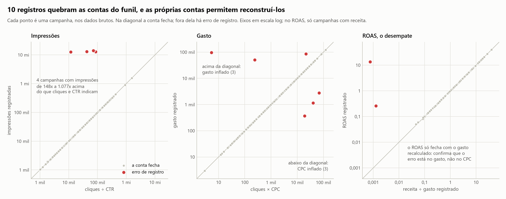
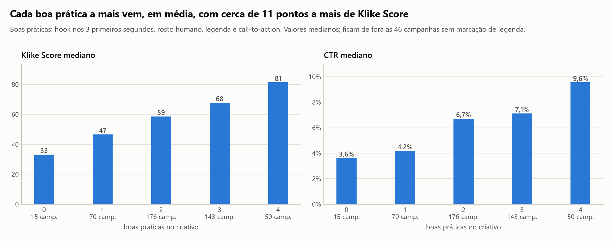
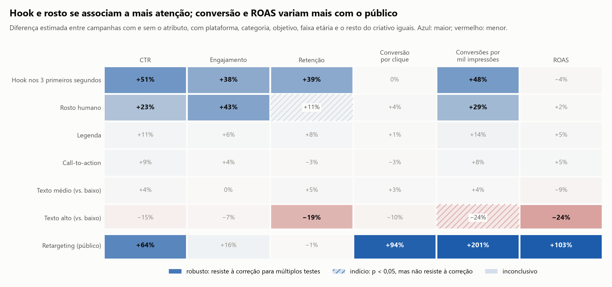
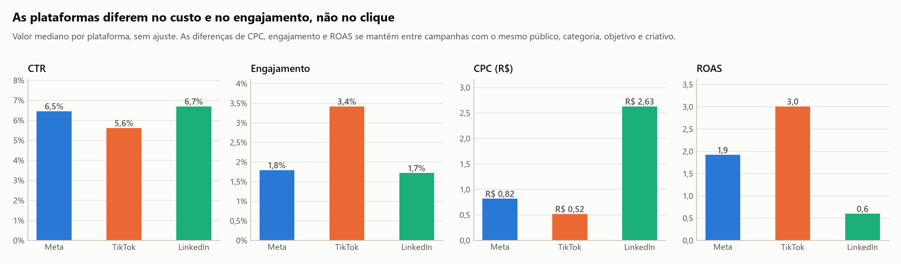
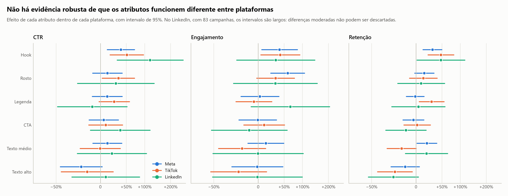
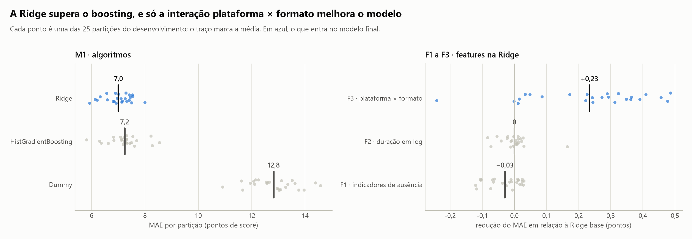

# Klike Data Science Challenge

Análise de 500 campanhas de vídeo em Meta, TikTok e LinkedIn para entender o que faz um criativo performar, prever o **Klike Score** e transformar isso em recomendações acionáveis.

**Autor:** Murilo Godoy

## Resumo

A Parte 1, de análise exploratória, em seis pontos:

- **A base tinha 10 registros inconsistentes,** em que as contas do funil não fecham. Todos foram corrigidos, sem descartar nenhuma campanha. Em 5, duas contas independentes confirmam qual valor está errado; nos outros 5, a escolha do valor se apoia em plausibilidade, e o log marca isso para revisão. Quatro deles triplicavam a média de impressões.
- **Hook e rosto humano são os atributos que mais pesam, e pesam na atenção.** Campanhas com hook têm CTR cerca de 50% maior, e com rosto, engajamento cerca de 40% maior. Não encontramos evidência de que se associem à conversão de quem clica ou ao ROAS.
- **Conversão e ROAS variam mais com o público:** com retargeting, os dois são cerca de duas vezes maiores.
- **Não encontramos evidência robusta de que algum atributo funcione diferente entre as plataformas,** o que não prova que os efeitos sejam iguais. O que muda é o patamar, mesmo entre campanhas parecidas: o clique no LinkedIn custa de 4 a 5 vezes o do TikTok, e o engajamento do TikTok é bem maior que o das outras. Na Meta, vídeos horizontais têm 5 pontos de score a menos que os verticais.
- **Duração não mostra efeito detectável** em nenhuma plataforma.
- **O Klike Score responde mais ao criativo que ao público,** mas dá pontos a legenda, CTA e texto médio, que não mostram efeito robusto em performance. Vale validar esses pesos.

| Parte | Pergunta do desafio | Onde está |
| :-- | :-- | :-- |
| 1.1 | Perfil dos dados, faltantes e outliers | [Seção](#parte-11--perfil-e-qualidade-dos-dados) e [notebook 01](notebooks/01_data_audit.ipynb) |
| 1.2 a 1.4 | Atributos que importam, padrões por plataforma e visualizações | [Seção](#partes-12-a-14--o-que-acompanha-a-boa-performance-dos-criativos) e [notebook 02](notebooks/02_eda_insights.ipynb) |
| 2 | Modelagem do Klike Score | [Seção](#parte-2--modelagem-do-klike-score) e [notebook 03](notebooks/03_modeling.ipynb) |

---

## A decisão que guia o case inteiro

Antes de qualquer gráfico, separei as colunas pelo **momento em que a informação existe**:

| Grupo | Exemplos | Quando existe |
| :-- | :-- | :-- |
| **Contexto** | plataforma, categoria, objetivo, público | antes da veiculação |
| **Criativo** | hook, rosto, legenda, CTA, duração, formato, densidade de texto | antes da veiculação |
| **Performance** | impressões, CTR, CPC, conversões, ROAS, engajamento | só depois da veiculação |

Um score que só pode ser calculado depois da veiculação não ajuda a decidir o que veicular. Por isso, um modelo que usa CTR para prever o score responde a uma pergunta menos útil do que parece: ele depende de algo que só existe depois do gasto. Essa separação define como o modelo é avaliado e o que o recommendations engine pode sugerir: só mudanças no criativo, que o time de criação controla.

---

## Como pensei

Três perguntas guiaram cada etapa:

1. **Os dados são confiáveis?** Antes de procurar padrões, conferi se as contas do funil fecham. Dez registros não fechavam, e corrigi-los mudou médias em até três vezes.
2. **O efeito é do criativo ou do contexto?** Atributos do criativo andam junto com plataforma, público e objetivo. Por isso, todo efeito compara campanhas parecidas em todo o resto. Sem esse cuidado, os vídeos quadrados do TikTok pareceriam ter 13 pontos de score a menos que os verticais, quando a diferença é de menos de 4.
3. **A diferença é real ou acaso?** Todo efeito tem intervalo de confiança, e cada família de testes recebe a correção de Benjamini-Hochberg. Só chamo de robusto o que resiste a ela; o resto é indício ou inconclusivo.

**O que deixei de fora de propósito:**

- **Remover outliers por regra estatística.** Corrigi só registros em que as contas do funil não fecham, e mantive os extremos reais.
- **Imputar faltantes antes do EDA.** Isso inventaria valores e vazaria informação para o modelo, como explica a Parte 1.1.
- **Comparar criativos por volume.** Volume mede verba, então usei taxas.
- **Recomendar mudanças de duração.** A base não mostra efeito.
- **Transformar zeros com log(1 + y).** O resultado muda com a unidade da métrica. Para manter as campanhas sem conversão, usei modelos de contagem.

---

## Parte 1.1 · Perfil e qualidade dos dados

> Notebook completo: [`notebooks/01_data_audit.ipynb`](notebooks/01_data_audit.ipynb)

A base é pequena e bem estruturada: 500 campanhas de 2024, sem duplicatas e sem categorias inválidas. Mas ela esconde **10 registros inconsistentes**, **7 colunas com faltantes** e **3 métricas que batem num limite**.

### Os erros foram encontrados com as próprias contas do funil

As métricas de mídia são redundantes entre si:

- impressões = cliques ÷ CTR
- gasto = cliques × CPC
- ROAS = receita ÷ gasto

Em vez de cortar outliers por uma regra estatística genérica, testei se essas contas fecham. Quando uma não fecha, as outras permitem **reconstruir** o valor e, em metade dos erros, apontam sozinhas **qual** campo está errado.

A regra genérica teria errado dos dois lados. Aplicada ao gasto bruto, a regra do intervalo interquartil marca 61 campanhas, 58 delas legítimas. Em escala log, os três gastos corrigidos nem chegam a ser marcados. As contas do funil isolam exatamente os 10 registros inconsistentes, sem marcar nenhuma campanha coerente.



Um exemplo: em três campanhas, gasto ≠ cliques × CPC. O ROAS desempata, porque foi calculado com o gasto verdadeiro. Ele mostra que o erro está no CPC, registrado entre R$ 20 e R$ 26 por clique quando o maior CPC legítimo da Meta é R$ 1,37. Nenhuma linha foi descartada, e cada correção fica registrada com a evidência em [`reports/data_corrections.csv`](reports/data_corrections.csv).

**Nem toda correção tem a mesma força, e o log diz qual é qual.** Em 5 dos 10 erros, duas contas independentes confirmam o campo errado, como no exemplo acima: a base é a **identidade**. Nos outros 5, as contas mostram o erro, mas não qual campo está errado. É o caso das 4 impressões, em que nenhuma conta separa impressões de CTR, e do KLK-0224, de Branding, sem receita para o ROAS desempatar. Ali a base é a **plausibilidade**: o código só corrige quando uma versão cai dentro da faixa observada nas campanhas em que as contas fecham e a outra cai fora dela. As alternativas ficam bem longe: um CTR de 8 a 80 vezes abaixo do menor da base, ou um CPC 3,5 vezes acima do maior da Meta. Se as duas versões fossem plausíveis, o registro iria para revisão manual. A coluna `basis` do log marca essas 5 para conferência com a fonte dos dados. Sem essas 5 campanhas, os principais efeitos ficam próximos: o hook no CTR vai de +51,3% para +51,1%, o rosto no engajamento, de +42,7% para +43,5%, e o hook no Klike Score, de +17,14 para +17,09 pontos. A exceção é o nível de evidência do texto alto no ROAS: o efeito quase não muda, de −24% para −22%, mas o resultado passa de robusto a indício (q de 0,028 para 0,055). É o único dos 68 testes da Parte 1.2 que muda de nível.

O impacto não é pequeno. **Quatro linhas, 0,8% da base, triplicavam a média de impressões**, e os três gastos corrigidos inflavam o gasto total em cerca de 11%.

### Decisões

| Situação | Casos | Decisão | Por quê |
| :-- | :-- | :-- | :-- |
| Impressões infladas | 4 | Recalcular: cliques ÷ CTR | Cliques confirmados pelo gasto; o CTR alternativo seria implausível (plausibilidade) |
| CPC fora de escala | 3 | Recalcular: gasto ÷ cliques | O ROAS confirma o gasto (identidade) |
| Gasto fora de escala | 3 | Recalcular: cliques × CPC | O ROAS confirma cliques × CPC em 2 (identidade); no KLK-0224, sem receita, só o CPC registrado é plausível (plausibilidade) |
| CPC e receita faltantes | 28 e 25 | Recuperar pelas mesmas contas | Recuperação exata no CPC; erro máximo de 0,5% do gasto na receita |
| Faltantes em duração, legenda, música/voz, tempo assistido e engajamento | 27 a 46 por coluna | Imputar dentro do pipeline do modelo, na Parte 2, ajustado só no treino. Legenda sem marcação vira a categoria "desconhecida"; indicadores de ausência foram testados na Parte 2 e ficaram de fora, por não trazerem ganho | Nenhum teste encontrou relação entre a ausência e as variáveis observadas, o que é compatível com MCAR; descartar perderia 30% da base |
| CTR travado em 15% e engajamento em 10% | 55 e 11 | Manter, com flag | Parecem tetos de registro: muitos valores exatamente no limite e nenhum acima. O valor real pode ter sido maior |
| Tempo médio assistido igual à duração do vídeo | 32 | Manter, com flag | Exigiria que todos vissem o vídeo inteiro; tratado como limite da métrica |
| Receita zero em Branding | 63 | ROAS "não se aplica" | Branding não mede receita, mesmo com conversões |
| Extremos coerentes, como uma campanha com 1,57 milhão de impressões | ex.: KLK-0435 | Manter; usar mediana e escala log | As contas fecham; é variação real |

### Ordem do tratamento dos dados

1. **Limpeza, antes de qualquer análise:** correção dos 10 registros inconsistentes, recuperação de CPC e receita, marcação dos tetos e do ROAS de Branding. Os dois notebooks carregam a base já limpa.
2. **EDA com os valores disponíveis:** os faltantes que restam, de 5% a 9% por coluna, não são imputados. Cada análise usa as campanhas que têm o valor, e a legenda ausente vira a categoria "desconhecida". Testei se a ausência é aleatória de três formas: a relação com cada outra coluna, um modelo tentando prever onde estão os faltantes e variáveis muito correlacionadas usadas como pista. Nenhuma mostrou sinal: a ausência é compatível com acaso (MCAR). Isso não prova MCAR, mas, se a ausência for aleatória, usar os valores disponíveis não distorce os resultados, e a tabela abaixo mostra que as conclusões não mudam com as alternativas.
3. **Imputação no pipeline do modelo, na Parte 2,** ajustada só nos dados de treino para não vazar informação do teste.

Imputar antes do EDA inventaria valores impossíveis, como vídeos assistidos por mais tempo do que duram, e não mudaria as conclusões. Refiz as estimativas principais das três formas:

| Efeito | Valores disponíveis | Imputação pela mediana | Só campanhas completas |
| :-- | :-- | :-- | :-- |
| Hook no CTR | +51% | +50% | +50% |
| Rosto no engajamento | +43% | +42% | +31% |
| Hook no Klike Score | +17,1 pts | +17,0 pts | +17,7 pts |

### O que isso muda nas próximas etapas

1. **Separar o efeito do criativo do efeito da plataforma.** O TikTok não tem nenhum vídeo horizontal, e o LinkedIn quase não tem público de 18 a 24 anos. Por isso, todo efeito é estimado com a plataforma como controle, e o formato é analisado dentro de cada plataforma.
2. **Usar mediana e escala log** para métricas de volume, que variam milhares de vezes entre campanhas.
3. **Analisar ROAS só fora de Branding.**
4. **Imputar só dentro do pipeline de modelagem**, nunca antes de separar treino e teste.
5. **Modelar o Klike Score diretamente.** Ele vai de 10 a 99, com média de 60, e é quase simétrico.

---

## Partes 1.2 a 1.4 · O que acompanha a boa performance dos criativos

> Notebook completo: [`notebooks/02_eda_insights.ipynb`](notebooks/02_eda_insights.ipynb)

**Como medi.** Volumes como cliques e conversões crescem com o orçamento, então comparo taxas: CTR, engajamento, retenção, conversão por clique, conversões por mil impressões e ROAS. Elas quase não andam juntas, e por isso acompanho todas. O Klike Score fica separado delas, porque é a métrica da própria Klike, não um resultado de mídia. Cada efeito vem de uma regressão que mantém fixos plataforma, categoria, objetivo, faixa etária, retargeting e os outros atributos do criativo. A leitura é: *entre campanhas parecidas em todo o resto, as que têm o atributo performam X% diferente*. É associação, não prova de causa; a confirmação viria de testes A/B.

**Quando um resultado conta.** Com dezenas de testes, alguns passariam de p < 0,05 só por acaso. Por isso, cada família de testes, o conjunto que responde a uma mesma pergunta, recebe a correção de Benjamini-Hochberg. Um resultado é **robusto** quando resiste à correção, **indício** quando só passa no teste isolado e **inconclusivo** quando nem isso. O notebook lista as oito famílias e o tamanho de cada uma.

Controlar o contexto muda as conclusões. Na comparação direta, os vídeos quadrados do TikTok parecem ter 13 pontos de score a menos que os verticais. Com o resto mantido igual, a diferença cai para menos de 4, porque só um terço desses vídeos tem hook, contra metade dos verticais.

### Boas práticas se somam



Em média, cada uma das quatro boas práticas, hook, rosto, legenda e CTA, vem com cerca de 11 pontos a mais de Klike Score. Elas não pesam igual: o hook se associa a cerca de 17 pontos, e legenda e CTA, a cerca de 8. Criativos com as quatro têm CTR mediano 2,6 vezes maior que criativos sem nenhuma.

### Parte 1.2 · Hook e rosto se associam a mais atenção



- **Hook é o atributo mais forte:** campanhas com hook têm 51% mais CTR, 38% mais engajamento e 39% mais retenção.
- **Rosto humano vem em segundo:** 43% mais engajamento e 23% mais CTR. Na retenção, +11%, fica só um indício, que não resiste à correção.
- **Não há evidência de que hook e rosto se associem à conversão de quem clica ou ao ROAS.** Ainda assim, campanhas com hook e rosto têm mais conversões por mil impressões, porque recebem mais cliques. O ROAS não acompanha por uma conta simples: ROAS é conversão por clique vezes ticket médio, dividido pelo CPC, e nenhum dos três tem diferença detectável com hook ou rosto.
- **Texto demais anda com desempenho pior.** Densidade alta vem com retenção 19% menor e ROAS 24% menor, em parte por um ticket médio menor. É o único atributo do criativo associado ao ROAS; esse resultado é robusto na base completa, mas o nível de evidência é sensível às 5 correções por plausibilidade da Parte 1.1. A queda nas conversões por mil impressões fica como indício.
- **Música e voz são ajuste fino.** Mais música se associa a um pouco mais de retenção e a um score um pouco menor, com efeitos pequenos.
- **Conversão e ROAS variam mais com o público.** Com retargeting, os dois são cerca de duas vezes maiores, mas o Klike Score é só 4,5 pontos maior, contra 17 do hook. O score se comporta como uma medida da qualidade do criativo, não do público.

**Os zeros não mudam as conclusões.** A regressão em log descarta as 19 campanhas sem conversão, todas sem retargeting. Refiz as estimativas de conversão e ROAS com dois modelos que mantêm os zeros: Poisson na taxa e binomial negativa, o modelo usual para contagens com sobredispersão. Hook, rosto e retargeting chegam à mesma conclusão em todos os modelos; texto alto também, exceto na conversão por clique, onde fica como indício. A novidade é um indício a favor da legenda nas conversões por mil impressões: +14% e inconclusivo no log, +23% e significativo na binomial negativa. Descartei log(1 + y), outra saída comum, porque o resultado depende da unidade: o efeito do hook iria de 0% a +85% só trocando "por impressão" por "por milhão".

**Um ponto para a própria Klike.** Score e performance concordam sobre hook, rosto e texto alto. Mas o score dá de 7 a 8 pontos para legenda, CTA e texto médio, que não mostram efeito robusto em nenhuma métrica de performance nesta base. A legenda tem só o indício nas conversões, que depende do modelo. Talvez esses efeitos existam e sejam pequenos demais para 500 campanhas; talvez o score siga boas práticas de mercado que estes dados não confirmam. Vale validar esses pesos com testes controlados.

### Parte 1.3 · Sem evidência de efeitos diferentes; o patamar muda



**As plataformas diferem no custo e no engajamento.** Nas medianas, o clique no LinkedIn custa cinco vezes o do TikTok, o ROAS mediano do LinkedIn fica abaixo de 1, e o engajamento do TikTok é quase o dobro do das outras. CTR, retenção e conversão por clique não diferem de forma significativa.

Essas medianas são uma comparação direta, e a composição das plataformas não é igual. A mistura de categorias, objetivos e retargeting é parecida, mas a de faixa etária muda muito: 44% das campanhas do TikTok falam com 18 a 24 anos, contra 2% no LinkedIn. Comparando campanhas com o mesmo público, categoria, objetivo e criativo, as diferenças continuam: o CPC do LinkedIn fica 4,6 vezes o do TikTok, e o engajamento do TikTok, 76% acima do da Meta. Na prática, um criativo deve ser comparado com o patamar da própria plataforma.



**Não encontramos evidência robusta de que algum atributo funcione diferente entre as plataformas.** Comparar quais efeitos dão significativos em cada plataforma engana, porque o LinkedIn tem três vezes menos campanhas. O teste certo compara os efeitos diretamente. Dos 30 testes, só 3 ficam abaixo de 0,05, contra 1,5 esperados por acaso, e nenhum resiste à correção para múltiplos testes. O mesmo vale para faixa etária, categoria e objetivo. Mas não ter evidência de diferença não prova que os efeitos sejam iguais: no LinkedIn, com 83 campanhas, o efeito do rosto no engajamento pode ir de −32% a +152%. A conclusão honesta é que a base não mostra diferença, e que diferenças moderadas não podem ser descartadas.

| | Meta | TikTok | LinkedIn |
| :-- | :-- | :-- | :-- |
| **Efeito dos atributos** | Sem diferença detectada | Sem diferença detectada | Sem diferença detectada; intervalos largos |
| **Patamar** | Referência | Engajamento 76% maior; CPC mais baixo; maior ROAS | CPC de 4 a 5 vezes o do TikTok; ROAS mediano abaixo de 1 |
| **Formato** | Horizontal com 5 pontos de score e 39% de engajamento a menos | Tendência a favor do vertical | Tendência a favor do horizontal |
| **Duração** | Sem efeito detectável | Sem efeito detectável | Sem efeito detectável |

Os detalhes de formato e duração estão em [`02_formato.png`](reports/figures/02_formato.png) e [`02_duracao.png`](reports/figures/02_duracao.png). Sobre duração, o senso comum diz que vídeos curtos performam melhor. Mas, mantendo o resto igual, dobrar a duração muda o CTR em +1%, com intervalo de −8% a +10%, e nenhum dos 12 testes de duração fica abaixo de 0,05.

### Parte 1.4 · As visualizações

Os seis gráficos das Partes 1.2 e 1.3 foram feitos para um time de marketing. Cada um responde uma pergunta e tem um título que já diz a resposta. Todos usam uma cor fixa por plataforma. No mapa de efeitos, azul é maior e vermelho é menor; cor forte marca resultado robusto, hachura marca indício, e cor apagada, inconclusivo.

### O que isso muda nas Partes 2 e 3

- **O modelo pré-veiculação tem boas chances de funcionar.** O Klike Score responde fortemente aos atributos do criativo e pouco ao público.
- **O engine vai ser contextual, sem depender de estimativas instáveis.** O efeito geral de cada atributo serve de referência, porque é o mais preciso. Sobre ele entra o contexto da campanha: o patamar da plataforma, a checagem de formato e, quando plataforma, categoria ou objetivo tiverem campanhas suficientes, a evidência do próprio segmento, puxada em direção ao efeito geral na proporção da sua incerteza. Assim, um grupo pequeno não gera uma recomendação baseada em ruído.
- **Toda recomendação vai trazer seu nível de evidência e separar score de performance.** Recomendar um CTA tende a subir o score, mas não há evidência de que melhore a performance, e o engine precisa dizer isso.
- **Duração fica fora das recomendações.** Não há evidência nesta base para sugerir mudanças.

---

## Parte 2 · Modelagem do Klike Score

> Notebook completo: [`notebooks/03_modeling.ipynb`](notebooks/03_modeling.ipynb)

A modelagem segue um protocolo definido antes dos experimentos formais. Esta seção registra as decisões e os resultados até a escolha do modelo; a certificação no teste e a interpretação entram aqui quando forem concluídas.

### Dois cenários, um principal

| | Modelo A · pré-publicação | Modelo B · pós-publicação |
| :-- | :-- | :-- |
| **Usa** | Contexto da campanha e atributos do criativo: 13 colunas | Tudo do modelo A, mais taxas de performance |
| **Papel** | Principal: pontua criativos novos e apoia o recommendations engine | Comparativo: mede quanto o score acompanha a performance realizada |

O modelo A é o principal porque é o único que pode ser usado antes de gastar, quando a decisão sobre o criativo acontece. Um teste automatizado impede que métricas de performance, o próprio score, o identificador ou a data entrem nele, e a mesma função prepara o histórico e uma campanha nova. O modelo B não serve para avaliar um criativo que ainda não foi veiculado. Uma ressalva vale para os dois: reproduzir o score da Klike numa base simulada não é o mesmo que prever vendas.

### O que a exploração inicial indicou

Antes do protocolo, uma exploração nas 500 campanhas mostrou que:

- o contexto sozinho não prevê o score;
- criativo e contexto juntos explicam cerca de dois terços da variação;
- um modelo linear foi melhor que um gradient boosting;
- as métricas de performance acrescentam explicação, mas só existem depois do gasto.

Esses números orientaram o plano e não valem como desempenho, porque a exploração viu todas as campanhas, inclusive as que depois foram para o teste.

### Como os modelos são avaliados

- **Desenvolvimento e teste.** 400 campanhas para desenvolver e 100 para o teste final, com a mesma proporção de plataformas. O teste é consultado uma única vez, depois que modelo, features e hiperparâmetros estiverem decididos.
- **Validação cruzada aninhada.** Os candidatos são comparados nas mesmas 25 partições do desenvolvimento, e os hiperparâmetros são escolhidos só dentro do treino de cada partição.
- **Decisão.** A métrica principal é o MAE, em pontos de score. Uma alternativa mais complexa precisa de uma melhora relevante e estável; na dúvida, fica a mais simples.
- **Checagem temporal.** Treinar nos três primeiros trimestres e avaliar no quarto, como robustez complementar.

### Experimentos e escolha do modelo



**M1 · Algoritmos.** A hipótese era que, com os efeitos aditivos vistos na Parte 1, um modelo linear bastaria. Nas mesmas 25 partições do desenvolvimento, com média e desvio entre elas:

| Modelo | MAE (pontos) | R² | Spearman |
| :-- | :-- | :-- | :-- |
| Dummy, a média do treino | 12,8 ± 0,9 | −0,01 | não se aplica |
| Ridge | 7,0 ± 0,5 | 0,69 | 0,82 |
| HistGradientBoosting | 7,2 ± 0,6 | 0,66 | 0,79 |

A Ridge erra, em média, 7 pontos numa escala de 0 a 100: 45% menos que o piso, com melhora em todas as partições. O boosting não melhora a Ridge: erra 0,23 ponto a mais e só a supera em 32% das partições. **Decisão: Ridge**, mais simples, mais estável e interpretável, já que cada coeficiente vira pontos de score.

**F1 a F3 · Features, na Ridge.** Cada alteração foi comparada com a Ridge base, nas mesmas partições:

| Experimento | Resultado | Decisão |
| :-- | :-- | :-- |
| F1 · indicadores de ausência para duração e música/voz | MAE 0,03 ponto pior; melhor em 40% das partições | Fica de fora: os indicadores não trouxeram ganho consistente. Isso é compatível com a Parte 1, mas não prova que a ausência seja aleatória |
| F2 · duração em log | Nenhuma diferença; cada versão vence em cerca de metade das partições | Fica de fora: no empate, fica a forma mais simples |
| F3 · interação plataforma × formato | MAE 0,23 ponto menor (3,3%); melhor em 92% das partições | Entra |

O F3 ficou abaixo da referência de 0,5 ponto do protocolo, então a decisão pesou os outros critérios: a melhora é muito estável, custa só três termos, mantém o modelo linear e deixa o efeito do formato específico de cada plataforma. Sem a interação, o modelo aplicaria o mesmo efeito de formato a todas as plataformas, embora o vídeo horizontal tenha score menor na Meta e seja o formato mais usado no LinkedIn. Combinações sem campanhas suficientes no treino, como TikTok horizontal, não ganham efeito próprio.

**Modelo escolhido:** Ridge com as 13 features de pré-publicação e a interação plataforma × formato. Nas partições do desenvolvimento, ele erra 6,78 pontos em média, mas essas são as mesmas partições que orientaram a escolha, então o número pode trazer algum otimismo de seleção. A estimativa que vale é a da certificação nas 100 campanhas reservadas, que até aqui não foram consultadas.

---

## Limitações

- **Associação, não causa.** Os efeitos comparam campanhas parecidas, mas algo não observado, como a qualidade da oferta, pode andar junto com o atributo. Testes A/B confirmariam.
- **A base é pequena e simulada.** São 500 campanhas, e só 83 no LinkedIn, onde os intervalos de confiança ficam largos.
- **CTR e engajamento parecem ter teto de registro:** muitos valores exatamente em 15% e 10%, e nenhum acima. Se for censura, as estimativas sobre essas métricas podem estar distorcidas, e a direção do viés depende de quais campanhas bateram no teto.
- **MNAR não pode ser descartado em música/voz e engajamento,** porque nenhuma variável observada é correlacionada o bastante com elas para servir de pista. Os testes mostram que a ausência é compatível com acaso, não que seja aleatória. Os indicadores de ausência testados na Parte 2 não trouxeram ganho e ficaram de fora; mesmo que entrassem, não corrigiriam um viés desse tipo.
- **Há poucos vídeos longos no TikTok:** só 5 passam de 30 segundos, então a base não testa vídeos longos nessa plataforma.
- **A exploração inicial da Parte 2 viu as 500 campanhas,** como a EDA, inclusive as que depois foram para o teste. O teste final não é totalmente intocado em relação às escolhas do plano: o protocolo limita esse efeito, mas não o elimina.
- **Não há identificador de criativo.** Nenhuma campanha repete todas as variáveis de pré-publicação de outra, mas isso não prova que versões do mesmo anúncio não estejam em lados diferentes da divisão entre desenvolvimento e teste.

---

## Como rodar

Requer Python 3.10 ou superior. Testado com Python 3.13.

```bash
python -m venv .venv
source .venv/bin/activate        # Windows: .venv\Scripts\activate
pip install -r requirements-dev.txt
pip install -e .

pytest                           # testes automatizados
jupyter lab notebooks/           # notebooks com a análise
```

Para reexecutar os notebooks do zero e regenerar as figuras:

```bash
jupyter nbconvert --to notebook --execute --inplace notebooks/01_data_audit.ipynb notebooks/02_eda_insights.ipynb notebooks/03_modeling.ipynb
```

O notebook 01 pode levar até um minuto e meio, por causa do teste de permutação dos faltantes.

## Estrutura do repositório

```
├── data/raw/                     dataset original, nunca alterado
├── notebooks/
│   ├── 01_data_audit.ipynb       Parte 1.1: perfil e qualidade dos dados
│   ├── 02_eda_insights.ipynb     Partes 1.2 a 1.4: o que acompanha a performance
│   └── 03_modeling.ipynb         Parte 2: modelagem do Klike Score
├── reports/
│   ├── data_corrections.csv      log de auditoria: cada correção, sua base e evidência
│   └── figures/                  gráficos exportados
├── src/klike/                    código reutilizável, importado pelos notebooks
│   ├── config.py                 caminhos, grupos de colunas e constantes
│   ├── data.py                   carregamento, validação e limpeza
│   ├── analysis.py               métricas comparáveis, efeitos e níveis de evidência
│   ├── modeling.py               features declaradas, divisão, validação e pipelines
│   ├── formatting.py             números no padrão brasileiro
│   └── viz.py                    estilo visual único dos gráficos
└── tests/                        testes automatizados (pytest)
```

A lógica fica em `src/klike` e os notebooks só a importam. Assim, a mesma limpeza roda nos notebooks, nos testes e, mais adiante, no recommendations engine.
