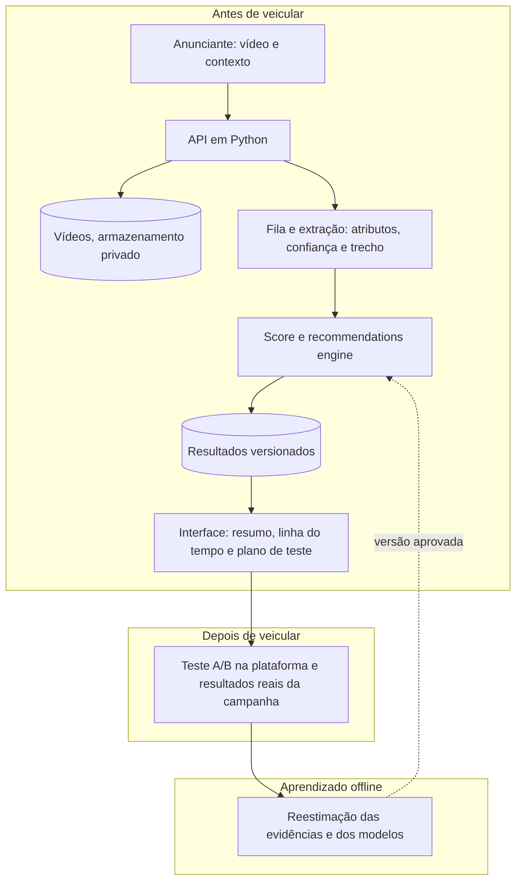

# Parte 4 · Visão de produto

Respostas às três perguntas da Parte 4 do desafio. O [README](../README.md) traz o resumo; aqui ficam o raciocínio e os exemplos.

## Em uma página

A proposta transforma o protótipo num ciclo de melhoria contínua dos criativos:

**compreender o vídeo → avaliar o criativo → recomendar melhorias → validar resultados → evoluir com as evidências.**

1. **Features do vídeo.** Primeiro, extrair do vídeo os oito atributos de criativo que o engine já usa, validando que a extração concorda com as marcações históricas antes de reaproveitar qualquer evidência. Depois, medir *quando* e *como* as coisas acontecem no vídeo, para recomendar edições localizadas no tempo.
2. **Produção.** Um serviço em Python que reaproveita o contrato, as regras e os testes do engine, com extração assíncrona do vídeo, resultados versionados e um laço de testes depois da veiculação. O gargalo é processar o vídeo, não prever o score.
3. **Mais tempo.** A prioridade é saber se as recomendações funcionam: testes A/B reais sobre uma base real de criativos. Depois vêm as features do vídeo, o diagnóstico pós-veiculação e os refinamentos estatísticos.

Ao longo do texto, cada parte indica a sua situação:

- **Existe:** está no repositório e foi testado.
- **Proposta:** desenho de produto, não implementado.
- **Depende de dados:** exige dados ou validação que ainda não temos.

## Ponto de partida

**O que existe.** O engine recebe os 13 atributos de pré-publicação de uma campanha, 5 de contexto e 8 do criativo, e devolve as edições que a base sustenta, em ordem de prioridade. Cada edição separa a diferença prevista de score, a associação histórica com a métrica do objetivo e a força dessa evidência, além do suporte histórico. A saída abre com um resumo executivo e está disponível em texto, tabela e JSON.

**Onde ele para:**

- **Os atributos dizem *se*, não *como* nem *quando*.** O hook é "sim" ou "não"; a densidade de texto é baixa, média ou alta.
- **O catálogo se esgota nos criativos fortes.** Na base, 247 das 500 campanhas recebem três ou mais recomendações, mas só 34 recebem três ou mais com evidência na métrica do objetivo. Das 100 campanhas com maior score previsto, 97 recebem menos de três e 20 nenhuma: elas já têm as práticas que o catálogo sugere.
- **Os atributos do criativo chegam prontos, como metadados, e têm lacunas.** Faltam a duração em 39 campanhas, a legenda em 46 e a proporção música/voz em 38. Não há identificador de criativo, então versões do mesmo anúncio não podem ser ligadas.
- **A evidência é observacional e vem de uma base simulada.** As associações não são efeitos causais, e nenhuma recomendação foi testada.
- **O score do protótipo não é o score da Klike.** É um modelo Ridge que reproduz o `klike_score` da base simulada a partir de metadados, treinado em 500 campanhas.

**O que a Klike já divulga.** Segundo o [site da Klike](https://www.klike.ai/), consultado em outubro de 2026, a plataforma divulga:
- análise de criativos e previsão de performance antes de publicar, com scores gerados por IA;
- recomendações e edição, para criativos de Meta, TikTok e LinkedIn;
- um teste A/B e API no plano Enterprise;
- que cada análise volta com o resultado real da campanha. O site menciona uma "conta conectada", sem detalhar a integração.

Não conhecemos a arquitetura interna, a escala do score nem o que cada funcionalidade faz em detalhe. Por isso, as propostas abaixo são conexões e aprofundamentos possíveis, não alegações de novidade. O que elas acrescentam é a rastreabilidade de cada recomendação, a separação entre previsão e evidência e a validação com resultados reais.

## Pergunta 1 · Que features extrairíamos do vídeo original?

### Fase 1: automatizar o contrato atual (proposta)

O vídeo fornece os 8 atributos do criativo, não os 13. Os 5 de contexto, que são plataforma, categoria, objetivo, faixa etária e retargeting, continuam vindo do briefing ou de uma integração com a conta de anúncios: nenhum vídeo diz qual é o objetivo da campanha.

- **Atributos objetivos:** a duração e a proporção do quadro vêm dos metadados do próprio arquivo e são exatas. A legenda e a densidade de texto vêm da leitura do texto na tela e da transcrição da fala. A proporção música/voz depende de análise do áudio, com separação entre voz e música; como a base não documenta como ela foi medida, a nova medida precisa ser validada contra a antiga.
- **Atributos que dependem de definição:** hook, rosto e CTA. "Hook nos 3 primeiros segundos" pode significar uma pergunta, um corte rápido ou o produto na tela; a definição usada na base não está documentada.
- **Concordância antes de herdar a evidência.** O +51% de CTR associado ao hook vem da marcação `has_hook` da base. Uma detecção automática só herda esse número depois de mostrar, numa amostra rotulada, que concorda com essa marcação, com os erros medidos.
- **Confiança explícita.** Cada atributo extraído traz o valor, a confiança, o trecho do vídeo e a origem: o método e a versão. Uma extração de baixa confiança fica como desconhecida ou vai para revisão humana. O engine já trata bem esse caso (**existe**): não sugere edição a partir de valor ausente e avisa na saída.
- **Ligar versões do mesmo anúncio.** Uma impressão digital do vídeo, como um hash perceptual, permite ligar versões quase iguais e separá-las por criativo nas validações, para que não fiquem dos dois lados da divisão entre treino e teste.

**O resultado:** o mesmo engine, com os oito atributos do criativo lidos do próprio vídeo, e menos lacunas neles. Os cinco de contexto continuam vindo do briefing ou da integração. Elas tendem a diminuir, mas não somem, porque a extração também falha.

### Fase 2: atributos temporais e semânticos (depende de dados)

Aqui está o ganho de produto: medir o que acontece em cada trecho do vídeo, para recomendar *onde* e *como* editar. Os métodos para isso são conhecidos: metadados do arquivo, leitura de texto na tela (OCR), transcrição da fala, detecção visual de rostos e objetos, e análise e separação das fontes de áudio. O trabalho está em definir e validar cada medida.

| O que medir no vídeo | Por que, pelo que a base mostrou | O que permitiria recomendar | Como validar |
| :-- | :-- | :-- | :-- |
| O que acontece nos primeiros 3 segundos: cortes, fala, produto, rosto, texto | O hook tem a associação mais forte (CTR +51%), mas é só "sim" ou "não" | Que tipo de abertura testar, e o que tirar dela | Concordância com `has_hook`; depois, associação com as métricas |
| Tempo até o produto ou o benefício aparecer | Criativos fortes ficam sem sugestão no catálogo atual | "O benefício só aparece aos 8 segundos" | Revisão humana numa amostra; associação |
| Rosto: momento da primeira aparição e tempo de tela, sem identificar a pessoa | Rosto: engajamento +43%, com evidência robusta | "Mostrar o rosto antes dos 2 segundos" | Concordância com `has_face`; associação |
| Texto: palavras por segundo, área ocupada, contraste e sobreposição com a interface de cada plataforma | Texto alto → médio: retenção +29%, robusta; hoje só existem três níveis | "Tirar o texto da área coberta pela interface" | Medidas objetivas; associação |
| Momento e forma do CTA: falado, escrito, no fim ou antes | O CTA só tem a seu favor o score previsto (classe C) | CTA antecipado contra CTA no fim | Associação; teste A/B |
| Fala e música: tempo com narração e trechos em que a música cobre a fala | Música +0,1 → retenção +3,9%, com o risco de perder a narração | "A música cobre a fala entre 5 e 9 segundos" | Associação; teste A/B |
| Ritmo: duração das cenas e cortes por segundo | A duração total não mostrou associação; o ritmo é uma hipótese ainda não testada | Localizar trechos lentos | Associação |
| Clareza da proposta de valor, avaliada por um modelo de linguagem | Não há variável equivalente na base | Sinalizar uma mensagem ambígua para revisão humana | Concordância com avaliadores humanos |

Nesta base, a retenção é o tempo médio assistido dividido pela duração, limitado a 1: uma proxy de atenção, e não a parcela de espectadores que viram o vídeo até o fim.

**Três regras para essas features:**

- **Nenhuma entra automaticamente no modelo atual.** Com 500 campanhas, mais variáveis aumentam o risco de sobreajuste. Cada uma passa pelo mesmo protocolo da Parte 2, com validação aninhada, e cada nova edição passa pela família de hipóteses da Parte 3, com correção para múltiplos testes e classes A, B e C.
- **Atributos de *como* e *quando* podem gerar sugestões para criativos que já seguem as práticas básicas.** É uma oportunidade para a cobertura, não a promessa de três recomendações comprovadas para todo vídeo.
- **O que não extrairíamos:** emoções "precisas", características demográficas ou a identidade das pessoas, e um suposto potencial de viralizar. São medidas difíceis de validar, sensíveis e pouco úteis para orientar uma edição concreta.

## Pergunta 2 · Como colocaríamos o engine em produção?

### O fluxo do usuário (proposta)

- **Antes de veicular:** o anunciante sobe o vídeo e informa o contexto da campanha, ou o importa da conta de anúncios. Em poucos minutos, vê o score, o resumo executivo e a linha do tempo do vídeo com as recomendações localizadas. Pode editar, reenviar e comparar versões.
- **Depois de veicular:** os resultados da campanha chegam pela integração com a plataforma. O produto compara a campanha com campanhas comparáveis e indica em que etapa do funil investigar. Se uma recomendação foi testada, o resultado do teste fica registrado junto dela.

Comparar duas versões antes de veicular e testá-las em A/B são coisas diferentes. A comparação responde, em minutos, qual versão o modelo prefere. Só um teste A/B com veiculação real indica qual versão performa melhor: as versões vão ao ar ao mesmo tempo, o público é alocado aleatoriamente entre elas, e a métrica principal e o período do experimento são definidos antes. O tamanho do teste precisa ser dimensionado pelo tráfego e pela variabilidade disponíveis.

### Arquitetura do MVP (proposta)



| Peça | Escolha no MVP | Por quê |
| :-- | :-- | :-- |
| Serviço | Uma API em Python, com o pacote `klike` | É a linguagem do protótipo: o contrato, a validação de entrada e as regras do engine são reaproveitados |
| Extração | Assíncrona, com fila e workers | Processar um vídeo leva minutos; a requisição não fica presa, e a extração escala de forma independente |
| Score | Para vídeos prontos, a pontuação real da Klike, se houver acesso autorizado e definição compatível; para edições ainda não gravadas, um modelo de atributos validado com dados reais | A Ridge do protótipo foi treinada em 500 campanhas simuladas e não vai para produção. Não presumimos que a escala seja de 0 a 100 |
| Evidências | Reestimadas com dados reais, pelo mesmo protocolo, e versionadas | Associação, classe e sensibilidade precisam vir da base em que o produto opera |
| Resultados | Banco relacional com cada recomendação e as versões do modelo, das evidências e da extração | Para responder, meses depois, por que um vídeo recebeu uma recomendação |
| Novas versões | Avaliadas offline, sem retreino automático a cada vídeo | Uma versão só entra depois de passar pelos portões de qualidade |

**O score não é uma peça trocável.** O engine atual usa a diferença de score prevista para cada edição: ela define a classe C, ordena as oportunidades de score e aparece em toda recomendação. Por isso, não basta trocar a Ridge por uma pontuação externa com outra definição ou escala. A pontuação real da Klike serviria para comparar vídeos já produzidos; estimar o score de uma edição ainda não feita exige um modelo de atributos validado com dados reais, ou capacidade equivalente. Até essa validação, as partes que dependem dessa estimativa precisam ser adaptadas ou ficar indisponíveis.

**O que se reaproveita do repositório (existe):**
- o contrato JSON, com o resumo executivo, a composição da lista, as ressalvas e o detalhe de cada recomendação;
- a validação de entrada com mensagens claras;
- as regras de classe, prioridade, suporte e avisos, inclusive o tratamento de valor ausente;
- o versionamento do arquivo do modelo, com o formato e a impressão digital dos dados;
- os testes automatizados e a auditoria de ponta a ponta, hoje com 19 verificações, como portão antes de publicar uma versão.

Não se reaproveitam os coeficientes estimados na base simulada.

**O que monitorar:**
- **Extração:** concordância com revisões humanas feitas por amostragem e parcela de extrações de baixa confiança.
- **Operação:** falhas, latência e custo por vídeo.
- **Modelo e evidências:** a parcela de recomendações com aviso de extrapolação (o suporte histórico já mede quando uma campanha cai fora da base), a distribuição das classes e o alinhamento entre o score e a performance real, quando ela chega.
- **Produto:** quantas recomendações são aceitas, consideradas úteis e testadas, e o resultado dos testes.

**Escala e custo.** O custo está no vídeo: decodificar, transcrever e analisar quadros leva minutos por vídeo. No protótipo, prever o score e montar as recomendações de uma campanha leva cerca de 20 milissegundos. Por isso:
- os workers escalam pela fila;
- o mesmo vídeo, reconhecido pela impressão digital, não é processado duas vezes;
- quadros são amostrados quando a análise não precisa de todos;
- uma nova versão do modelo reavalia os criativos em lote.

**Privacidade.** Os vídeos ficam em armazenamento privado, com controle de acesso e retenção limitada. Os rostos são detectados sem reconhecer a pessoa. Nada vai para fornecedores externos sem contrato e consentimento, e as integrações respeitam os termos de uso das plataformas e a LGPD.

**Fora do MVP:** microsserviços e orquestração de contêineres, retreino automático, edição automática do vídeo e IA generativa tomando decisões.

## Exemplo aplicado: hoje e com o vídeo

### Hoje (existe): KLK-0024

Trecho da saída real do engine para uma campanha de conversões na Meta:

```
4 recomendações: 3 com evidência na métrica do objetivo (2 de classe A e 1 de classe B) e 1 hipótese de score (classe C).

Principais recomendações (3 de 4):
   1. Incluir um hook nos 3 primeiros segundos · classe A
      conversões por mil impressões +48% (de +26% a +75%), evidência robusta · score +17,0
      Ressalvas: associação, não causa (validar em A/B)
```

A recomendação diz *o quê* e *por quê*, mas não *onde* nem *como*: o engine só sabe que o vídeo não tem hook.

### Com o vídeo (proposta, ilustrativo)

*Os trechos abaixo são inventados para ilustrar a experiência; não vêm de um vídeo real.*

| Trecho | O que o vídeo mostra | Leitura |
| :-- | :-- | :-- |
| 0 a 3 s | Logotipo e cena institucional, sem fala | Produto e benefício não aparecem; hipótese a testar: abrir pelo produto |
| 3 a 8 s | Narração sobre a empresa | O benefício principal ainda não apareceu |
| 8 a 12 s | Demonstração do produto, com um rosto | O primeiro momento com produto e pessoa |
| 12 a 15 s | CTA escrito na tela | O CTA aparece só no fim |

**Recomendação:** testar uma versão que comece pela demonstração do produto e leve o logotipo para depois.

**Evidência:** na base, ter hook se associa a 48% mais conversões por mil impressões, com evidência robusta. Esse número vale para a marcação `has_hook`. A versão sugerida só herda a evidência se a detecção da abertura concordar com essa marcação; até lá, é uma hipótese de edição, não um ganho previsto.

**Plano de teste:**
- **Versões:** A, a original; B, com a abertura nova.
- **Métrica principal, definida antes:** conversões por mil impressões. Custo por resultado e CTR servem de salvaguarda.
- **Desenho:** as duas versões vão ao ar ao mesmo tempo, com o público alocado aleatoriamente pela ferramenta de teste da plataforma e o mesmo orçamento. O período e o volume são planejados antes de começar, conforme o tráfego e a variabilidade da campanha.
- **Leitura:** o resultado vale para esta edição neste contexto. Um teste isolado não reclassifica a evidência geral; ele se soma aos outros na próxima reestimação.

### Depois de veicular (proposta, com dados da base simulada): KLK-0291

A KLK-0291 é uma campanha de conversões na Meta, de E-commerce e sem retargeting. O score observado é 89,1, entre os 2% maiores da base. O criativo já tem hook, rosto, CTA e texto médio, e a legenda está sem marcação; por isso, o engine não tem nenhuma recomendação para ela. Comparada com as 84 campanhas de conversões na Meta:

| Métrica | KLK-0291 | Mediana do grupo | Posição no grupo |
| :-- | :-- | :-- | :-- |
| CTR | 5,4% | 6,5% | percentil 43 |
| Conversão por clique | 0,8% | 3,2% | percentil 4 |
| Conversões por mil impressões | 0,41 | 2,15 | percentil 10 |
| ROAS | 0,45 | 2,36 | percentil 2 |

O clique fica perto do típico; o que fica muito abaixo é a conversão depois do clique. Na Parte 1, a conversão por clique e o ROAS variaram mais com o público do que com o criativo: com retargeting, os dois são cerca de duas vezes maiores, e hook e rosto não mostraram associação com eles. Um diagnóstico pós-veiculação indicaria por onde começar a investigar: a oferta, a página de destino e o público. Ele não concluiria que o criativo está bom nem que o problema está só ali.

**Cuidados:**
- a base é simulada;
- o grupo inclui 20 campanhas com retargeting, e esta não usa retargeting;
- são só 7 conversões em 919 cliques, pouco para uma taxa estável;
- preço, estoque, sazonalidade e leilão não estão na base.

O caso também mostra por que vale acompanhar o alinhamento entre score e performance.

## Pergunta 3 · O que faríamos com mais tempo?

A ordem segue as limitações documentadas nas Partes 1 a 3, não a sofisticação das técnicas.

| # | Iniciativa | Limitação que resolve | Valor | Esforço | Depende de | Quando |
| :-- | :-- | :-- | :-- | :-- | :-- | :-- |
| 1 | Validar as recomendações com testes A/B reais, registrando a recomendação, a edição feita e o resultado | Associação não é efeito, e nenhuma recomendação foi testada | Muito alto | Médio | Integração com a conta de anúncios e registro das recomendações | Primeiro |
| 2 | Base real com identificadores de criativo, versão e anunciante, validada por período e por criativo | Base simulada, sem identificador de criativo, avaliada nas próprias campanhas | Alto | Médio | Acesso aos dados da Klike | Primeiro |
| 3 | Features do vídeo: a Fase 1 e depois a Fase 2, ampliando o catálogo de edições | Atributos binários, lacunas e criativos fortes sem sugestão | Alto | Alto | Iniciativa 2 e uma amostra rotulada | Em seguida |
| 4 | Diagnóstico pós-veiculação e alinhamento entre score e performance | O score dá pontos a legenda, CTA e texto médio sem evidência de performance; casos como a KLK-0291 | Alto | Baixo a médio | Dados reais da iniciativa 2 | Em seguida |
| 5 | Comparar versões reais e priorizar por impacto e custo de produção | Edições combinadas nunca foram estimadas; incluir legenda custa menos que regravar com rosto | Médio | Baixo | Fase 1 da iniciativa 3 | Em seguida |
| 6 | Refinamentos estatísticos e contextuais: efeitos por segmento com modelos hierárquicos (que combinam o efeito geral com o de cada segmento), incerteza do score por campanha, tetos de CTR e engajamento, ausências não aleatórias e formas não lineares | LinkedIn com 83 campanhas; erro descrito só pela média; tetos de registro | Médio | Médio | Volume de dados das iniciativas 1 e 2 | Depois |
| 7 | Assistência generativa para explicar recomendações ou propor variações de roteiro | Produtividade da equipe criativa | Incerto | Médio | Iniciativas 1 e 3 | Depois |

**Por que essa ordem.** As iniciativas 1 e 2 vêm primeiro porque tudo o mais depende de saber se as recomendações funcionam e de ter dados reais; a 3 traz o maior ganho de produto, mas precisa delas. A 6 só faz sentido com volume, porque com 83 campanhas no LinkedIn efeitos por segmento seriam ruído, e a 7 só ajuda quando a camada de evidência estiver de pé.

**Como os testes alimentam a evidência.**
- Cada teste estima o resultado de uma edição num contexto, com a métrica principal definida antes.
- Os resultados se acumulam e entram na reestimação periódica das evidências. Nenhuma classe muda por causa de um único experimento.
- Não calculamos agora o tamanho de amostra dos testes: a base é por campanha, e a variância que importa num teste com público real é por pessoa, um dado que a base não tem. Um número aqui seria precisão falsa; cada teste real precisa ser dimensionado com o tráfego e a variabilidade da própria campanha.

**O que deliberadamente não faríamos:**
- trocar a Ridge por um modelo mais complexo antes de ter dados reais. Na Parte 2, o boosting não superou a Ridge, e o ganho mais provável vem de dados, não de algoritmo;
- retreinar o modelo a cada vídeo recebido;
- somar efeitos para prever o resultado de várias edições juntas;
- inferir emoção, demografia ou "viralização";
- usar IA generativa como fonte de evidência ou de números de impacto;
- prometer três recomendações comprovadas para todo vídeo.
